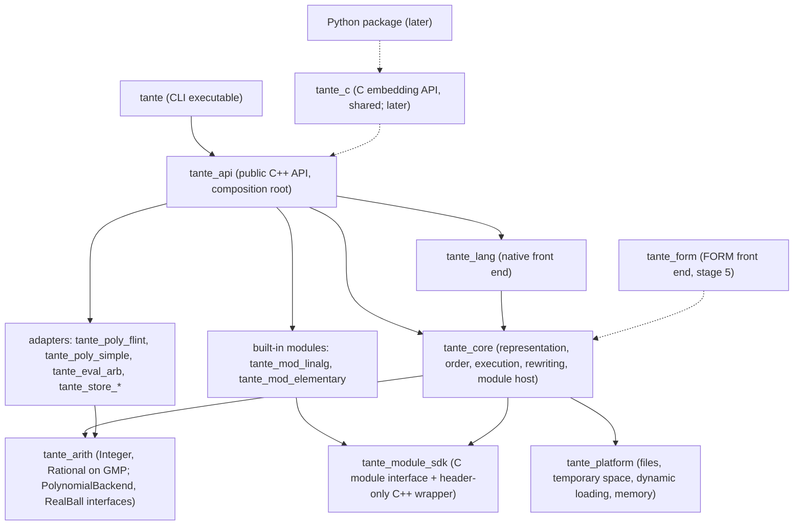

# ADR-0004: Tante is a library with a thin command-line tool, split into build targets whose dependencies the build enforces; every module, built-in or third-party, connects through the one C module interface

- **Status:** Proposed
- **Date:** 2026-10-16

## Context

Four requirements fix the shape of the code before any of it is written:

- [REQ-064](../requirements.md#req-064): everything the command line does is available through a programming interface the command line itself uses, so that the C++ library ([REQ-061](../requirements.md#req-061)), the Python package ([REQ-062](../requirements.md#req-062)) and notebooks ([REQ-063](../requirements.md#req-063)) add bindings rather than restructuring. Acceptance: the command-line tool contains no calculation logic.
- [REQ-030](../requirements.md#req-030): a public, documented extension interface through which a module adds kinds of object, functions, rules, conventions and output formats. Acceptance: the first release's linear algebra ([REQ-014](../requirements.md#req-014)) is itself a module using only that interface. [REQ-099](../requirements.md#req-099) asks the same of the elementary functions.
- [REQ-032](../requirements.md#req-032): modules are developed, built and distributed outside the repository and loaded by name or path without rebuilding the engine; a **script module** is native-language declarations and rules, a **compiled module** connects through a C interface kept stable within a major version of [REQ-031](../requirements.md#req-031), which also requires every result to record the modules and versions that produced it.
- [REQ-096](../requirements.md#req-096): every external library is used only through an interface of Tante's own; no code outside the adapter refers to the library. Acceptance: the architecture names each interface.

Two accepted records already fix parts of this. [ADR-0001](0001-cpp20-cmake-vcpkg-guardrails.md) §4 chose a C interface (`extern "C"`, C types, opaque handles, status codes) for compiled modules and bindings, and a C++ interface that is source-compatible but not binary-compatible. [ADR-0003](0003-flint-gmp-arb-behind-own-interfaces.md) §2 made each library adapter a separate build target, so the build itself keeps FLINT's headers out of the rest of the engine, and left open whether compiled modules see `Integer` and `Rational` through the C interface.

Two further obligations constrain the split: both front ends produce the same kind of object ([REQ-022](../requirements.md#req-022)), and the FORM front end must later be addable as "a parser and modules" ([REQ-025](../requirements.md#req-025)).

A note on vocabulary for a .NET reader. A CMake **target** is the counterpart of a project in a solution: a library or executable with its own sources and references. A **static library** is compiled code that is copied into whatever links it, as if every referenced assembly were merged into the executable; a **shared library** (`.dll`, `.so`, `.dylib`) is loaded at run time, like an assembly. CMake's `target_link_libraries(a PRIVATE b)` means `a` uses `b` but code that uses `a` does not see `b`, the counterpart of a project reference that does not flow on to the projects that reference yours. Loading a shared library by path at run time (`LoadLibraryW` on Windows, `dlopen` elsewhere) is the counterpart of `Assembly.LoadFrom`; calling a C function in it is what P/Invoke does.

## Decision

**Tante is built as a set of library targets with one direction of dependency, a public C++ API that is the only thing the command-line tool may use, and one module interface defined in C, through which the built-in modules connect exactly as third-party ones do. The build graph and an include check in CI enforce the dependency rules.** The parts:

### 1. Targets



| Target | Kind | Responsibility |
|---|---|---|
| `tante_arith` | static | `Integer` and `Rational`, Tante's value types, whose implementation alone includes `gmp.h`; the abstract interfaces `PolynomialBackend` and `RealBall`, and the neutral polynomial form of [ADR-0003](0003-flint-gmp-arb-behind-own-interfaces.md) §2. |
| `tante_poly_flint`, `tante_poly_simple` | static | The two `PolynomialBackend` implementations of [ADR-0003](0003-flint-gmp-arb-behind-own-interfaces.md); only the first includes FLINT. |
| `tante_eval_arb` | static | Numerical evaluation by ball arithmetic ([REQ-101](../requirements.md#req-101)); only target that includes FLINT's `arb` headers besides the FLINT polynomial adapter. |
| `tante_store_*` | static | Implementations of the expression-storage interface (in memory now, on disk with [REQ-054](../requirements.md#req-054)); the interface itself is the subject of the record on term representation. |
| `tante_platform` | static | Everything that differs between Windows, macOS and Linux: UTF-8 file paths, temporary directories unique per job ([REQ-051](../requirements.md#req-051)), loading a shared library, querying memory. The only Tante code with `#ifdef _WIN32`. |
| `tante_core` | static | Terms and expressions, canonical order, the execution of a calculation, pattern matching, the module registry and the host side of the module interface, provenance, errors. Calculation logic lives here and nowhere above it. |
| `tante_module_sdk` | header-only | `tante_module.h`, the C module interface, and `tante/module.hpp`, a header-only C++ wrapper over it (§3). Installed for third-party module authors. |
| `tante_mod_linalg`, `tante_mod_elementary` | static | The first release's built-in modules ([REQ-014](../requirements.md#req-014), [REQ-099](../requirements.md#req-099)). They link **only** `tante_module_sdk`. |
| `tante_lang` | static | The native language ([REQ-013](../requirements.md#req-013)): parsing a script into the engine's representation of a calculation, and printing results as text and LaTeX ([REQ-057](../requirements.md#req-057)). |
| `tante_form` | static, stage 5 | The FORM front end ([REQ-020](../requirements.md#req-020)): a second parser into the same representation; it depends on `tante_core`, never on `tante_lang`, and vice versa. |
| `tante_api` | static | The public C++ API (`include/tante/`): a session, loading scripts and modules, running a calculation, reading results, saving and loading ([REQ-100](../requirements.md#req-100)). It is the **composition root**: the one place that chooses which adapters are used and hands them to the core, as `Program.cs` registers services in a .NET host. |
| `tante` | executable | The command-line tool ([REQ-060](../requirements.md#req-060)): arguments, reading script files, writing output and diagnostics, exit status ([REQ-051](../requirements.md#req-051)), the interactive session. It links only `tante_api`. |
| `tante_c` | shared, later | The C embedding API of [ADR-0001](0001-cpp20-cmake-vcpkg-guardrails.md) §4, a thin layer over `tante_api` for the Python package and other languages. Not in the first release ([REQ-006](../requirements.md#req-006)); its place is reserved so that [REQ-062](../requirements.md#req-062) adds a layer and nothing below it. |

The C++ libraries are **static**. The C++ API is source-compatible only ([ADR-0001](0001-cpp20-cmake-vcpkg-guardrails.md) §4), so nothing is gained by shipping it as a shared library, and doing so on Windows would require marking every exported class, which is fragile across compilers. The one shared library Tante will ship, `tante_c`, exports only C functions. Compiled modules do not link against the engine at all (§3), so they need no shared engine library to link to.

### 2. Dependency rules

1. Dependencies point downwards in the diagram and never back. `tante_core` knows nothing of front ends, the command line or a particular library.
2. **The command-line tool uses only `tante_api`.** Any behaviour the tool offers is a call to the API; the tool parses arguments, reads and writes files, and formats exit codes ([REQ-064](../requirements.md#req-064)).
3. **Only an adapter includes a third-party library's headers** ([REQ-096](../requirements.md#req-096)): `gmp.h` only in `tante_arith`'s implementation of `Integer` and `Rational`; FLINT only in `tante_poly_flint` and `tante_eval_arb`; later libraries (compression, a tensor canonicaliser) in their own adapter targets. Third-party types never appear in a Tante header other than the adapter's private ones.
4. **Built-in modules use only the module interface**: `tante_mod_*` link only `tante_module_sdk`, so they can use nothing a third-party module could not ([REQ-030](../requirements.md#req-030)).
5. The two front ends are independent of each other and of the command line, and both produce the core's representation ([REQ-022](../requirements.md#req-022), [REQ-025](../requirements.md#req-025)).
6. Platform-specific code lives only in `tante_platform` ([REQ-050](../requirements.md#req-050)).
7. Interfaces whose implementation is chosen at run time (`PolynomialBackend`, numerical evaluation, expression storage) are abstract classes in the lower target and are wired up only in `tante_api`. `Integer` and `Rational` are concrete value types for speed; they are replaceable at build time by replacing their implementation file, not at run time.

**Enforcement.**

- **The build graph.** Each rule above that is a "may use" is a `target_link_libraries` entry, and every link is `PRIVATE` unless a public header of the target needs the other's types. A target that does not link another cannot include its headers, because the other's include directory is not on its path.
- **An include check in CI.** vcpkg installs every library's headers into one directory, so a target that legitimately reaches GMP through one link would see FLINT's headers too; the build graph alone does not stop that. A short script (`tools/check_architecture.py`) reads each source file's `#include` lines and fails CI if a directory includes a header it may not, against a table that states rules 2 to 6. It runs with the checks of [ADR-0001](0001-cpp20-cmake-vcpkg-guardrails.md) §5.
- **A build without FLINT.** One CI job configures with FLINT switched off: only `tante_poly_simple` is built, numerical evaluation reports itself unavailable, and the test suite runs with the tests that need FLINT skipped and named. It proves on every change that nothing outside the adapters needs FLINT ([REQ-096](../requirements.md#req-096) acceptance).
- **An out-of-tree module.** `examples/module-hello` is a separate CMake project that finds Tante's installed SDK (`find_package(Tante)`, then `Tante::module_sdk`), builds a compiled module, and a test loads it by path from a script. It proves [REQ-032](../requirements.md#req-032) on all three systems on every change.
- **API-level tests.** Every behaviour of the command-line tool has a test that calls `tante_api` directly, and the tool's own tests check only argument handling, files and exit codes.

### 3. The module interface

One interface serves every module, so that what the engine's own modules do proves the interface sufficient.

- **The binary contract is C** (`tante_module.h`), as [ADR-0001](0001-cpp20-cmake-vcpkg-guardrails.md) §4 requires. A compiled module is a shared library exporting one function, `tante_module_entry`, which receives a table of engine functions (creating and inspecting expressions, declaring objects, registering rules and callbacks, reporting errors) and returns a descriptor: the module's name and version, the interface version it was built against, the modules it requires, and what it provides. The engine checks the interface's major version before anything else and refuses a mismatch with an error naming the module ([REQ-031](../requirements.md#req-031)). The module never links the engine; it reaches the engine only through the table it was given, in the way a COM object receives its host's interfaces.
- **The C++ wrapper** (`tante/module.hpp`) is header-only: it is compiled by the module author's own compiler, so it carries no binary-compatibility risk, and it gives module authors RAII handles, `std::string_view` and exceptions instead of C status codes. Every callback crosses the C boundary through a wrapper function that catches any exception and turns it into a status code, since an exception must never cross C code ([ADR-0001](0001-cpp20-cmake-vcpkg-guardrails.md) §3).
- **Built-in modules** are written against the same wrapper and linked into the engine statically. The engine calls their `tante_module_entry` exactly as it calls a loaded one; the only difference is that the function's address is known at build time instead of being looked up in a file.
- **Numbers cross the interface as opaque handles**, settling the question [ADR-0003](0003-flint-gmp-arb-behind-own-interfaces.md) left open: a module receives `tante_rational*` handles with engine functions for arithmetic, comparison, conversion from and to decimal text and from and to 64-bit integers. GMP's types are never part of the module interface, so a module neither depends on GMP nor breaks if Tante replaces it.
- **Script modules** are native-language files, loaded by the same statement as compiled ones and recognised by their file extension; the front end turns them into the same declarations and rules a compiled module registers.
- **Loading and lifetime.** A module is loaded by name (searched in the script's directory, the directories of a `TANTE_MODULE_PATH` variable, then the installation's module directory) or by path. A module stays loaded until the session ends; nothing is unloaded mid-calculation, which removes a class of lifetime errors. The registry records each loaded module's name and version for provenance ([REQ-075](../requirements.md#req-075)).
- **What the interface can express** (the kinds of object, rules and callbacks) is filled in by the records on term representation, pattern matching and the execution model. This record fixes the mechanism, not the vocabulary. Callbacks may be called from several worker threads at once ([REQ-052](../requirements.md#req-052)); the precise contract is the execution-model record's.
- Which built-in modules a script gets without loading them (the elementary functions, presumably) is a decision of the native language and is stated in its reference documentation.

### 4. Source layout

```
include/tante/          public C++ API (tante_api)
include/tante/module/   module SDK: tante_module.h and module.hpp
src/arith/  src/adapters/{flint,simple,arb,store-memory}/  src/platform/
src/core/   src/lang/   src/api/   src/cli/   (src/form/ at stage 5)
modules/linalg/  modules/elementary/
examples/module-hello/
tests/      tools/
```

Public C++ names are in namespace `tante`; everything else is in `tante::detail` or a namespace per target, and is not installed.

## Alternatives considered

- **Built-in modules on an internal C++ interface, with the C interface only for third-party modules:** faster calls and richer types for the engine's own modules, and the strongest alternative. Not chosen because there would then be two module interfaces to maintain, and the C interface that third parties depend on would never be exercised by real modules, so [REQ-030](../requirements.md#req-030)'s acceptance would prove the wrong interface sufficient. The cost of the choice is an indirect call and a handle per crossing, which is small beside the polynomial and term work each callback does; it is to be measured (Consequences).
- **One library, with layers kept apart only by namespaces and review:** the simplest build. Not chosen: nothing would stop the command line or a module from reaching into the core, and [REQ-064](../requirements.md#req-064) and [REQ-096](../requirements.md#req-096) would be enforced only by attention, which a single maintainer cannot spend on every change.
- **A shared C++ engine library, with compiled modules linking against it:** usual on Linux. Not chosen: C++ has no binary interface stable across compilers ([REQ-032](../requirements.md#req-032)), and exporting C++ classes from a Windows DLL is fragile.
- **Modules in another process, talking over a pipe or socket:** isolates a crashing module. Not chosen: a module's callbacks run per term, and copying terms between processes would cost far more than the work done on them.
- **An embedded scripting language (Lua, Python) for modules:** not chosen; [REQ-032](../requirements.md#req-032) makes script modules native-language files, and a second language would have to be documented and kept in step.
- **C++20 named modules to enforce layering:** set aside by [ADR-0001](0001-cpp20-cmake-vcpkg-guardrails.md) §1 for now.
- **Adapters chosen at build time only, including the polynomial back end:** simpler, but [REQ-097](../requirements.md#req-097) has the user select the polynomial implementation per run, so it must be a run-time choice.

## Consequences

- Easier: the command-line tool, the Python package and notebooks are all clients of one API; the FORM front end is a new target beside `tante_lang` with no change below it; a library is replaced by adding an adapter target and changing the composition root.
- Easier: a third-party module author has the same tools and the same reach as the engine's own modules, and the out-of-tree example keeps that true.
- Harder: about a dozen targets from the start, a CMake package configuration to install the SDK, and an include-check script to maintain.
- Harder: the C module interface is a public, versioned contract from the first release. Every function added to it is kept for the whole major version, so it should grow by need, not in advance.
- Harder: built-in modules work through handles and the C++ wrapper rather than the core's types, which is more verbose than direct access.
- Follow-up: the record on term representation defines the storage interface and what a "kind of object" is, and so what the module interface can say about objects; the records on pattern matching and the execution model define rules, callbacks and their threading contract; the record on errors defines the status codes and messages at the C boundary.
- Follow-up: `tools/check_architecture.py`, the build without FLINT and `examples/module-hello` are added with the first code, with the CI workflow Thomas is to approve ([ADR-0001](0001-cpp20-cmake-vcpkg-guardrails.md) Consequences).
- Untested: the cost of a call across the C module interface per term, compared with a direct C++ call. It is to be measured alongside the term-encoding spike of the record on term representation, before the interface's shape for per-term callbacks is fixed. If it proved prohibitive, the remedy would be callbacks that receive many terms at once, not a second interface.
