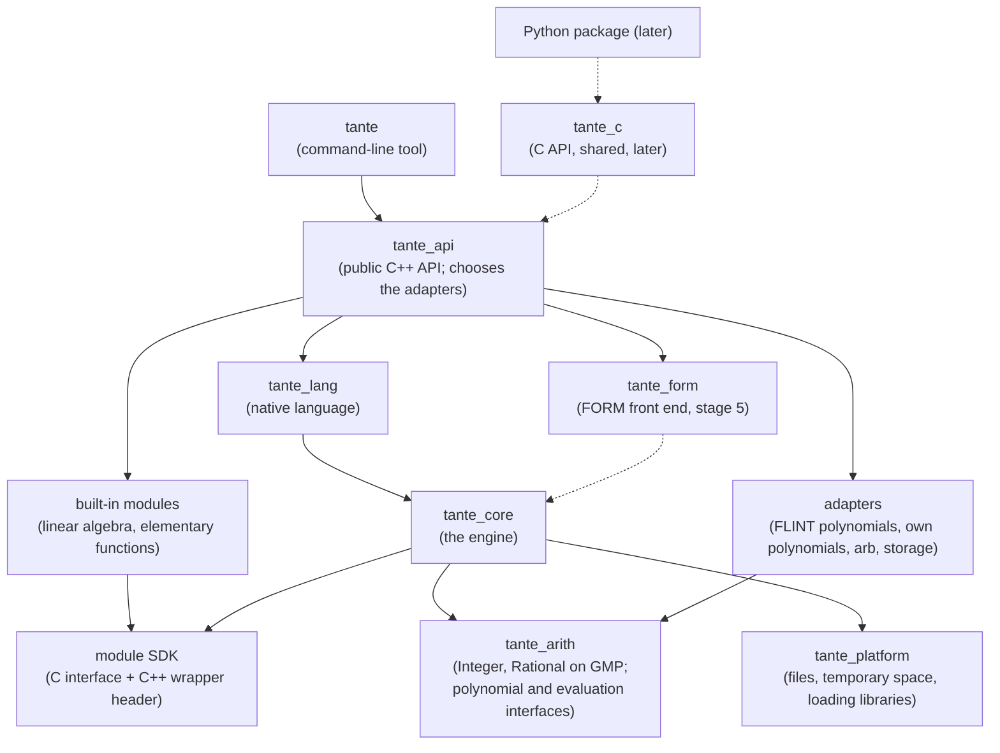

# ADR-0004: Tante is a library with a thin command-line tool, split into build targets whose dependencies the build enforces; every module, built-in or third-party, connects through the one C module interface

- **Status:** Accepted (Thomas, by merging [pull request #1](https://github.com/thomaswening/Tante/pull/1) on 19 October 2026)
- **Date:** 2026-10-16, revised 2026-10-19 after Thomas's decisions

## Context

Four requirements fix the shape of the code before any of it is written:

- [REQ-064](../requirements.md#req-064): the command-line tool contains no calculation logic; everything it does goes through a programming interface that the C++ library ([REQ-061](../requirements.md#req-061)), the Python package ([REQ-062](../requirements.md#req-062)) and notebooks ([REQ-063](../requirements.md#req-063)) will also use.
- [REQ-030](../requirements.md#req-030): [modules](../glossary.md#module) extend the engine through a public interface, and the first release's linear algebra ([REQ-014](../requirements.md#req-014)) is itself a module using only that interface; [REQ-099](../requirements.md#req-099) asks the same of the elementary functions.
- [REQ-032](../requirements.md#req-032): third-party modules are built outside the repository and loaded without rebuilding the engine; compiled modules connect through a [C interface](../glossary.md#c-interface) that stays stable within a major version of [REQ-031](../requirements.md#req-031).
- [REQ-096](../requirements.md#req-096): every external library is reached only through an interface of Tante's own, and no code outside its adapter refers to it.

[ADR-0001](0001-cpp20-cmake-vcpkg-guardrails.md) §4 already chose a C interface for compiled modules and bindings, and a C++ interface that is source-compatible but not binary-compatible. [ADR-0003](0003-flint-gmp-arb-behind-own-interfaces.md) §2 made each library adapter its own build target and left open whether modules see `Integer` and `Rational`. Both [front ends](../glossary.md#front-end) must produce the same kind of object ([REQ-022](../requirements.md#req-022)), and the FORM front end must be addable later as a parser and modules ([REQ-025](../requirements.md#req-025)).

Vocabulary, for a .NET reader:

- A CMake **target** is a project in a solution: a library or executable with its own sources and references.
- A **static library** (`.lib`, `.a`) is machine code the linker copies into the executable at build time, as if every referenced assembly were merged into one executable.
- A **shared library** (`.dll`, `.so`, `.dylib`) is loaded at run time, like an assembly. Unlike an assembly it has no compiler-neutral metadata: the layout of a C++ class, even of `std::string`, is the compiler's private choice ([MSVC](../glossary.md#msvc) and [GCC](../glossary.md#gcc) differ, and so do MSVC's Debug and Release builds), so C++ types exported from a shared library work only with the compiler that built it. Plain C functions and types have one fixed convention per platform. This is why the module boundary is C.
- A **handle** is a pointer to a type whose contents the holder cannot see, like an `IntPtr` it can only pass back to the engine. C has neither garbage collection nor destructors, so every handle the engine hands out must be released by the holder, as a .NET `SafeHandle` must be disposed.

The decisions below were put to Thomas as a brief and decided by him on 19 October 2026.

## Decision

**Tante is built as static library targets with dependencies in one direction, a public C++ [API](../glossary.md#api) that is all the command-line tool may use, and one [module interface](../glossary.md#module-interface) defined in C, used by the built-in modules exactly as by third-party ones. The build graph and three checks in CI enforce the rules.**



An arrow means "may use"; nothing points upwards. The targets are listed in the [appendix](#appendix-targets-and-source-layout).

1. **Dependency rules.** The command-line tool uses only `tante_api` ([REQ-064](../requirements.md#req-064)). Only an adapter includes a third-party library's headers ([REQ-096](../requirements.md#req-096)). Built-in modules use only the module SDK ([REQ-030](../requirements.md#req-030)). The two front ends are independent of each other ([REQ-022](../requirements.md#req-022)). Platform-specific code lives only in `tante_platform` ([REQ-050](../requirements.md#req-050)). Run-time choices (the polynomial implementation of [REQ-097](../requirements.md#req-097), storage) are made only in `tante_api`.
2. **One module interface (Thomas: option a).** The binary contract is C (`tante_module.h`): a compiled module is a shared library exporting `tante_module_entry`, which receives a table of engine functions and returns the module's name, version, required interface version, required modules and what it provides. The engine checks the interface's major version first ([REQ-031](../requirements.md#req-031)). **Tante ships a C++ wrapper, `tante/module.hpp`, as a header**: authors include it and it is compiled with their own compiler, so it carries no compatibility risk; it gives them [RAII](../glossary.md#raii) handles and exceptions, and catches every exception before it reaches C. Built-in modules use the same wrapper and are linked in statically; the engine calls their entry function as it calls a loaded one.
3. **Static libraries (Thomas: option a).** The engine's C++ targets are static and compiled into `tante` by one compiler. The only shared library Tante ships is the later C API `tante_c`, which exports only C functions. Modules do not link against the engine; they reach it only through the table they are given.
4. **Numbers as handles (Thomas: option a).** Numbers cross the module interface as [opaque `tante_rational*` handles](../glossary.md#opaque-handle) with engine functions for arithmetic, comparison and conversion; [GMP](../glossary.md#gmp)'s types never appear in it. This settles the question [ADR-0003](0003-flint-gmp-arb-behind-own-interfaces.md) left open.
5. **Enforcement (Thomas: all three).** The build graph: every link is `PRIVATE` unless a public header needs it. An **include check** (`tools/check_architecture.py`) fails CI on any `#include` a directory may not use; it is needed because [vcpkg](../glossary.md#vcpkg) installs all libraries' headers in one folder, so the build graph alone cannot hide [FLINT](../glossary.md#flint) from code that may use GMP. A **build without FLINT** proves nothing outside the adapters needs it. An **out-of-tree example module** (`examples/module-hello`, a separate CMake project using the installed SDK) is built and loaded by a test on all three systems ([REQ-032](../requirements.md#req-032)). Every behaviour of the command-line tool also has a test against `tante_api` directly.

## Alternatives considered

- **An internal C++ interface for built-in modules, C only for third parties:** faster calls for the engine's own modules, and the strongest alternative. Not chosen: two interfaces to maintain, and the C interface third parties depend on would have no real user inside the project, so its gaps would surface only when an outside author hit them. Its speed advantage can be had later without its cost (Consequences).
- **One library, layers kept apart by namespaces and review:** simplest. Not chosen: a single maintainer cannot check every change by attention alone.
- **A shared C++ engine library that modules link against:** C++ has no binary interface stable across compilers ([REQ-032](../requirements.md#req-032)).
- **The wrapper as a pre-compiled library:** would be machine code from Tante's compiler and reintroduce the compatibility problem. Shipping it as source (a header now, possibly a `.cpp` as well if it grows) avoids it.
- **Modules in a separate process:** isolates crashes, but copying [terms](../glossary.md#term) between processes per callback would cost far more than the work done on them.
- **An embedded scripting language for modules:** [REQ-032](../requirements.md#req-032) makes script modules native-language files.
- **C++20 named modules to enforce layering:** set aside by [ADR-0001](0001-cpp20-cmake-vcpkg-guardrails.md) §1.

## Consequences

- Easier: the command-line tool, the Python package and notebooks are clients of one API; the FORM front end is a new target beside `tante_lang`; a library is replaced by adding an adapter and changing `tante_api`.
- Easier: third-party authors have the same tools and reach as the engine's own modules, and the example module keeps that true.
- Harder: about a dozen targets, an installed CMake package for the SDK, and the include-check script to maintain.
- Harder: the C module interface is a public contract from the first release; every function added is kept for the major version, so it grows by need.
- Untested: the cost of a call through the C module interface per term. It is measured in the [spike](../glossary.md#spike) of the record on term representation, which comes next. **If it matters, the remedy is a second implementation of the C++ wrapper that calls the core directly** (Thomas, 19 October 2026): built-in modules compile against it for speed, while CI also builds and tests them through the C interface, so it stays exercised. To keep this possible, modules use only the wrapper's API, never the C handles directly, and the wrapper's API is designed so that the second implementation can be added without changing module code.
- Follow-up: the records on term representation, pattern matching and the execution model define what the module interface can express (kinds of object, rules, callbacks, their threading contract); the record on errors defines status codes at the C boundary.
- Follow-up: the include check, the build without FLINT and the example module are added with the first code, together with the CI workflow Thomas is to approve ([ADR-0001](0001-cpp20-cmake-vcpkg-guardrails.md)). The dependency diagram moves into `docs/architecture.md` §5 when it is drafted, and is kept current there.

## Appendix: targets and source layout

| Target | Kind | Responsibility |
|---|---|---|
| `tante_arith` | static | `Integer` and `Rational`, whose implementation alone includes `gmp.h`; the interfaces `PolynomialBackend` and `RealBall`; the neutral polynomial form of [ADR-0003](0003-flint-gmp-arb-behind-own-interfaces.md) §2. |
| `tante_poly_flint`, `tante_poly_simple` | static | The two polynomial implementations of [ADR-0003](0003-flint-gmp-arb-behind-own-interfaces.md); only the first includes FLINT. |
| `tante_eval_arb` | static | Numerical evaluation by [ball arithmetic](../glossary.md#ball-arithmetic) ([REQ-101](../requirements.md#req-101)). |
| `tante_store_*` | static | [Expression](../glossary.md#expression) storage, in memory now and on disk with [REQ-054](../requirements.md#req-054); the interface is the record on term representation's. |
| `tante_platform` | static | UTF-8 file paths, temporary directories unique per job ([REQ-051](../requirements.md#req-051)), loading shared libraries, querying memory; the only code with `#ifdef _WIN32`. |
| `tante_core` | static | Terms, expressions, [canonical order](../glossary.md#canonical-order), execution, pattern matching, the module registry and host side of the module interface, provenance, errors. |
| `tante_module_sdk` | header-only | `tante_module.h` and `tante/module.hpp`; installed for module authors. |
| `tante_mod_linalg`, `tante_mod_elementary` | static | The first release's built-in modules ([REQ-014](../requirements.md#req-014), [REQ-099](../requirements.md#req-099)); link only the SDK. |
| `tante_lang` | static | The native language ([REQ-013](../requirements.md#req-013)): parsing, and printing as text and LaTeX ([REQ-057](../requirements.md#req-057)). |
| `tante_form` | static, stage 5 | The FORM front end ([REQ-020](../requirements.md#req-020)). |
| `tante_api` | static | The public C++ API (`include/tante/`): sessions, scripts, modules, results, saving and loading ([REQ-100](../requirements.md#req-100)); the one place that chooses adapters, as `Program.cs` registers services in a .NET host. |
| `tante` | executable | Arguments, script files, output, diagnostics, exit status ([REQ-051](../requirements.md#req-051)), the interactive session ([REQ-060](../requirements.md#req-060)). |
| `tante_c` | shared, later | The C embedding API for Python and other languages; not in the first release ([REQ-006](../requirements.md#req-006)). |

Proposed by Claude, not yet discussed: modules are loaded by name (searched in the script's directory, then the directories in `TANTE_MODULE_PATH`, then the installation's module directory) or by path, and stay loaded until the session ends; which built-in modules a script gets without loading them is the native language's decision. Public names are in namespace `tante`, internal ones in `tante::detail` or a namespace per target.

```
include/tante/          public C++ API
include/tante/module/   module SDK
src/arith/  src/adapters/{flint,simple,arb,store-memory}/  src/platform/
src/core/   src/lang/   src/api/   src/cli/   (src/form/ at stage 5)
modules/linalg/  modules/elementary/  examples/module-hello/  tests/  tools/
```
