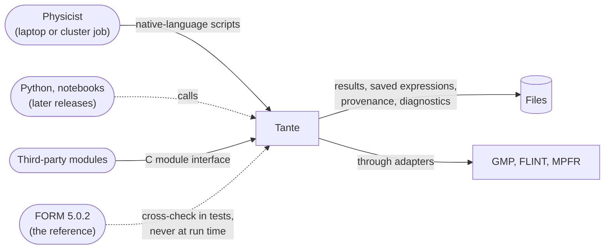
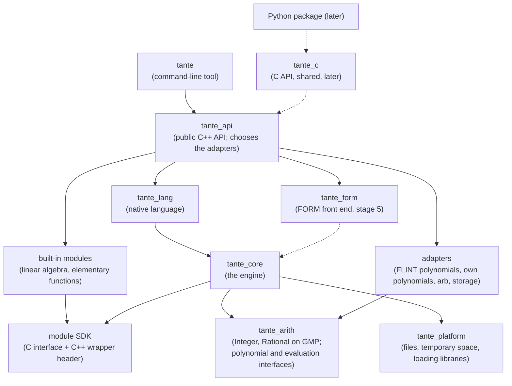
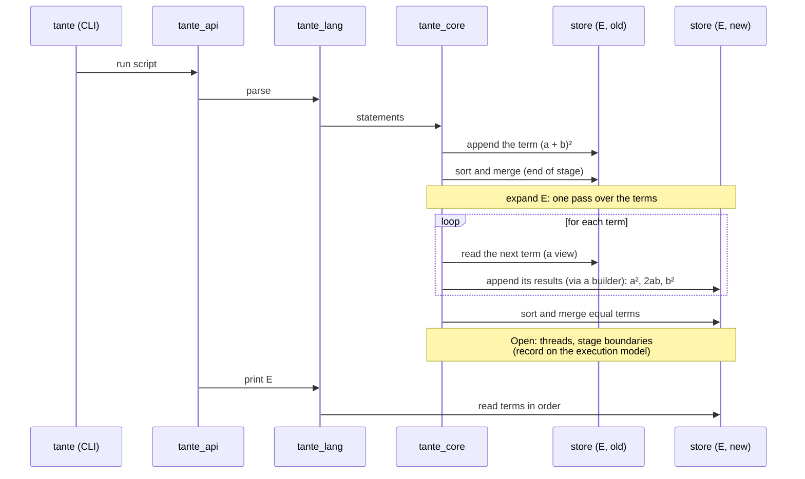

# Tante: Architecture overview
Draft | 25 October 2026 | Based on requirements v0.19

This document gives an overview of how Tante is built and why. **What** Tante must do is defined in [requirements.md](requirements.md). **Why** each part is built the way it is is recorded in the [architecture decision records](adr/README.md) ([ADRs](glossary.md#adr)), and measured evidence in [spikes](glossary.md#spike). The order of the work is in the [roadmap](roadmap.md). Specialist vocabulary is linked to the [glossary](glossary.md) on first use.

The document follows [arc42](glossary.md#arc42), a standard outline for architecture documents. Each part is marked:

- **Implemented**, when it is built and tested;
- **Planned**, when an accepted ADR has decided it but it is not built yet;
- **Open**, when it waits on a record not yet written, or on a measurement.

On 25 October 2026 no code exists, so nothing is Implemented. Thomas decided the content of this document on 25 October 2026, after a brief in chat: the order of the goals in section 1, the three maps of [section 7](#7-where-later-capabilities-enter), the [runtime view](#6-runtime-view), this document as the home of the living diagram of section 5, and the risks.

## 1. Goals

Tante performs exact symbolic calculations for physicists, as a research tool first and a learning tool built on it ([REQ-001](requirements.md#req-001)). It is a new engine, not a fork of FORM, because FORM's structure is hard to understand, maintain and extend ([REQ-004](requirements.md#req-004)).

The architecture is driven by these [quality goals](glossary.md#quality-goal), in priority order:

| Priority | Quality goal | What it means here | Main requirements |
|---|---|---|---|
| 1 | **Correctness** | Exact arithmetic. A [canonical form](glossary.md#canonical-form), so that equal results print identically. Results cross-checked against independent sources. | [REQ-012](requirements.md#req-012), [REQ-018](requirements.md#req-018), [REQ-070](requirements.md#req-070), [REQ-071](requirements.md#req-071) |
| 2 | **Determinism and provenance** | Byte-identical output whatever the number of threads, the machine or the run. Every result records what produced it. | [REQ-074](requirements.md#req-074), [REQ-075](requirements.md#req-075) |
| 3 | **Scale and speed** | $10^6$ [terms](glossary.md#term) in 16 GB. Within a stated factor of FORM. Several threads. No sizes fixed in advance. | [REQ-052](requirements.md#req-052) to [REQ-056](requirements.md#req-056), [REQ-098](requirements.md#req-098) |
| 4 | **Extensibility** | [Modules](glossary.md#module) are added without rebuilding the engine. External libraries are replaceable behind Tante's own interfaces. | [REQ-030](requirements.md#req-030), [REQ-032](requirements.md#req-032), [REQ-096](requirements.md#req-096) |
| 5 | **Understandability** | A developer new to the project can make and test a change without help. | [REQ-004](requirements.md#req-004), [REQ-092](requirements.md#req-092) |
| 6 | **Portability** | Native on Windows, macOS and Linux, with identical output. | [REQ-050](requirements.md#req-050) |

When goals conflict, the higher one wins. The trades this order decides, one for each neighbouring pair:

- **Correctness over determinism.** A faster factorisation whose answer depends on the run is not used until its output is normalised. A result that is reproducible but wrong is worth nothing.
- **Determinism over speed.** Terms produced by several threads are merged in a fixed order, even where merging them as they arrive would be faster.
- **Speed over extensibility.** Built-in modules call the core directly rather than through the [C module interface](glossary.md#module-interface), because that call cost 1.2 to 1.8 times a direct one ([ADR-0005](adr/0005-term-representation.md) point 7).
- **Extensibility over understandability.** One C module interface with two C++ wrapper implementations is more to learn than one internal interface. Third-party modules are worth that cost.
- **Understandability over portability.** Platform-specific code stays in one [target](glossary.md#target), even where a fix elsewhere would be shorter.

Understandability ranks fifth although it is why Tante exists. An engine that is clear but cannot reach $10^6$ terms fails its users, while a fast engine can still be documented. Among options that are equally fast, the clearer one wins.

## 2. Constraints

- **Language and build:** C++20, CMake and [vcpkg](glossary.md#vcpkg), built and tested on all three systems on every change. Warnings are errors. [Sanitizers](glossary.md#sanitizer) and [static analysis](glossary.md#static-analysis) run in CI ([ADR-0001](adr/0001-cpp20-cmake-vcpkg-guardrails.md)).
- **Libraries:** [GMP](glossary.md#gmp) for integers, [FLINT](glossary.md#flint) for polynomials and for numerical evaluation by [ball arithmetic](glossary.md#ball-arithmetic), [MPFR](glossary.md#mpfr) as FLINT's own dependency. Each sits behind an interface of Tante's own ([ADR-0003](adr/0003-flint-gmp-arb-behind-own-interfaces.md)).
- **No input from Symbolica**, of any kind ([ADR-0002](adr/0002-no-input-from-symbolica.md)).
- **Platforms:** 64-bit Windows, macOS and Linux, natively, without administrator rights ([REQ-050](requirements.md#req-050)). Batch jobs on clusters ([REQ-051](requirements.md#req-051)).
- **Licence:** [GPL](glossary.md#gpl)-3.0-or-later ([REQ-080](requirements.md#req-080)).
- **Developer:** one maintainer, Thomas, a .NET developer learning C++. Choices favour code that tools check over code that needs care, and documents a newcomer can follow ([REQ-092](requirements.md#req-092)).

## 3. Context

Solid arrows are first-release paths. Dashed arrows come later or are used only by the tests.

The physicist writes scripts in the native language and runs them with the command-line tool, on a laptop or unattended on a cluster ([REQ-013](requirements.md#req-013), [REQ-060](requirements.md#req-060)). Results go to files as plain text, LaTeX and Tante's binary save format ([REQ-057](requirements.md#req-057), [REQ-100](requirements.md#req-100)). Each result file is accompanied by its provenance ([REQ-075](requirements.md#req-075)). Third-party modules are shared libraries or native-language files that a script loads ([REQ-032](requirements.md#req-032)). [FORM](glossary.md#reference) appears only in the tests, as an independent cross-check and as the definition of what a FORM script means ([REQ-020](requirements.md#req-020), [REQ-071](requirements.md#req-071)).

## 4. Solution strategy

1. **A library with a thin command-line tool.** Everything the tool does goes through a public C++ [API](glossary.md#api), which later bindings for Python and notebooks will also use ([REQ-064](requirements.md#req-064), [ADR-0004](adr/0004-library-first-target-structure.md)).
2. **Static targets with one-way dependencies, enforced by the build.** The [include check](glossary.md#include-check), a build without FLINT and an out-of-tree example module make the rules fail CI, not just review ([ADR-0004](adr/0004-library-first-target-structure.md) point 5).
3. **[Terms](glossary.md#term) are flat, pointer-free [blocks](glossary.md#block) of 32-bit [words](glossary.md#word).** A term can be copied, written to disk and compared without translation ([ADR-0005](adr/0005-term-representation.md)). This is what makes [expressions](glossary.md#expression) larger than memory addable later.
4. **An expression is a stream of terms behind a [store](glossary.md#store).** No code holds an expression as a whole. A store is sorted, and equal terms merged, at the end of each [stage](glossary.md#stage). Statements read a term through a [view](glossary.md#view) and write their results through a [builder](glossary.md#builder) ([ADR-0005](adr/0005-term-representation.md) point 5).
5. **One module interface, in C.** Built-in modules use it as third-party ones do. They differ only in that their [module wrapper](glossary.md#module-wrapper) calls the core directly ([ADR-0004](adr/0004-library-first-target-structure.md), [ADR-0005](adr/0005-term-representation.md) point 7).
6. **Every external library behind an [adapter](glossary.md#adapter).** A library is replaced by adding an adapter. Tante's own simple polynomial implementation proves the interface is independent of FLINT ([REQ-096](requirements.md#req-096), [REQ-097](requirements.md#req-097), [ADR-0003](adr/0003-flint-gmp-arb-behind-own-interfaces.md)).
7. **Order from names, never from addresses or creation.** The [canonical order](glossary.md#canonical-order) depends only on names and declared properties, so the output is the same for any number of threads ([REQ-012](requirements.md#req-012), [REQ-074](requirements.md#req-074)). How the order is defined is for the record on canonical order. **Open.**

## 5. Building blocks

This section holds the living diagram and table of Tante's [targets](glossary.md#target). [ADR-0004](adr/0004-library-first-target-structure.md) keeps its copy as the record of what was decided on 19 October 2026. A change that adds, removes or rewires a target updates this section in the same pull request.

An arrow means "may use". Nothing points upwards. Dashed boxes and arrows belong to later releases. Built-in modules compile against the direct implementation of the module wrapper, so in practice they call `tante_core` ([ADR-0005](adr/0005-term-representation.md) point 7). CI also builds them against the C implementation.

| Target | Kind | Responsibility | Status |
|---|---|---|---|
| `tante_arith` | [static library](glossary.md#static-library) | `Integer` and `Rational`, whose implementation alone includes GMP. The interfaces `PolynomialBackend` and `RealBall`. The neutral polynomial form passed to the back ends. | Planned |
| `tante_poly_flint`, `tante_poly_simple` | static | The two polynomial implementations. Only the first includes FLINT. | Planned |
| `tante_eval_arb` | static | Numerical evaluation by ball arithmetic ([REQ-101](requirements.md#req-101)). | Planned |
| `tante_store_memory` | static | The in-memory store. | Planned |
| `tante_store_disk` | static | A store on disk for expressions larger than memory ([REQ-054](requirements.md#req-054)). | Open (a later release) |
| `tante_platform` | static | UTF-8 file paths, temporary directories unique per job ([REQ-051](requirements.md#req-051)), loading [shared libraries](glossary.md#shared-library), querying memory. The only code with `#ifdef _WIN32`. | Planned |
| `tante_core` | static | Terms (view and builder), expressions, the module registry and the engine side of the module interface. | Planned |
| | | Canonical order, execution, pattern matching, provenance, errors. | Open (records to come) |
| `tante_module_sdk` | header-only | `tante_module.h` and `tante/module.hpp`, installed for module authors. | Planned |
| `tante_mod_linalg`, `tante_mod_elementary` | static | The first release's built-in modules ([REQ-014](requirements.md#req-014), [REQ-099](requirements.md#req-099)). | Planned |
| `tante_lang` | static | The native language: parsing, and printing as text and LaTeX ([REQ-013](requirements.md#req-013), [REQ-057](requirements.md#req-057)). | Planned |
| `tante_form` | static | The FORM [front end](glossary.md#front-end) ([REQ-020](requirements.md#req-020)). | Planned for stage 5 of [OPEN-K](requirements.md#open-k) |
| `tante_api` | static | The public C++ API: sessions, scripts, modules, results, saving and loading. The one place that chooses adapters, as `Program.cs` registers services in a .NET host. | Started: `tante::version()` |
| `tante` | executable | Arguments, script files, output, diagnostics, exit status, the interactive session ([REQ-060](requirements.md#req-060)). | Started: `tante --version` |
| `tante_c` | shared library | The C embedding API for Python and other languages. | Planned for a later release |

### Dependency rules

- The command-line tool uses only `tante_api`. It contains no calculation logic ([REQ-064](requirements.md#req-064)).
- Only an adapter includes a third-party library's headers ([REQ-096](requirements.md#req-096)).
- Built-in modules use only the module SDK ([REQ-030](requirements.md#req-030)).
- The two front ends are independent of each other ([REQ-022](requirements.md#req-022)).
- Platform-specific code lives only in `tante_platform` ([REQ-050](requirements.md#req-050)).
- Run-time choices, such as the polynomial implementation or the store, are made only in `tante_api` ([REQ-097](requirements.md#req-097)).
- Only the term view and builder in `tante_core` read or write the words of a term ([ADR-0005](adr/0005-term-representation.md) point 6).

These rules are enforced by the build graph (every link `PRIVATE` unless a public header needs it), by the [include check](tools/check_architecture.md), by a build without FLINT and by the out-of-tree example module `examples/module-hello`, built and loaded by a test on all three systems ([ADR-0004](adr/0004-library-first-target-structure.md) point 5). The build graph and the include check are in place. The other two arrive in phase 1 of the [roadmap](roadmap.md#phase-1-foundations), with FLINT and the module SDK.

## 6. Runtime view

The building-block diagram shows which parts exist. This [runtime view](glossary.md#runtime-view) shows what they do, in order, while one script runs. The script is `E = (a + b)^2; expand E; print E;` in an illustrative syntax, since the native language's syntax is not designed yet.

- **The first three calls** show the library-first rule: the command-line tool only hands the script to `tante_api`.
- **The loop** never holds the expression as a whole. It reads one term and appends that term's results to a new store. That is why a store on disk can replace the one in memory without changing this picture ([REQ-054](requirements.md#req-054)).
- **Each sort and merge ends a stage.** Merging is where equal terms combine: two terms $ab$ from different sources become $2ab$.
- **Open:** how the loop is split across threads, where exactly a stage ends, and how statements are grouped into one pass. The record on the execution model decides these and refines this diagram.

## 7. Where later capabilities enter

Three requirements are accepted on what this section says: each asks the architecture to name where a capability of a later release will enter, so that adding it needs no restructuring. A row marked Open names the record that will settle it.

### 7.1 FORM concepts ([REQ-025](requirements.md#req-025))

The FORM front end arrives at stage 5 ([OPEN-K](requirements.md#open-k)) as a parser and modules. Each FORM concept is carried by a part of Tante:

| FORM concept | Example | Carried by | Status |
|---|---|---|---|
| Declarations | `Symbols x, y; CFunction f;` | The session's tables of names and properties ([ADR-0005](adr/0005-term-representation.md) point 4), filled by the parser in `tante_form` | Planned |
| Expressions | `Local E = (x + y)^2;` | An [expression](glossary.md#expression) as a stream of terms in a store ([ADR-0005](adr/0005-term-representation.md) point 5) | Planned |
| Rational-function [coefficients](glossary.md#coefficient) | `PolyRatFun rat;` | The [`RATFUN`](glossary.md#ratfun) coefficient ([ADR-0005](adr/0005-term-representation.md) point 3) | Planned |
| `.sort` stages | `.sort` | The end of a stage: the store's sort and merge. How statements, threads and stages fit together is for the record on the execution model. | Open |
| `id` statements with [wildcards](glossary.md#wildcard) | `id f(x?) = x^2;` | Pattern matching over term views ([REQ-011](requirements.md#req-011)); the record on pattern matching | Open |
| [Dollar variables](glossary.md#dollar-variable) | `$n = $n + 1;` | Cross-term state with a declared reduction (sum, maximum, minimum), or a step that runs on one thread and says so ([REQ-074](requirements.md#req-074) (b)); the record on the execution model | Open |
| The [preprocessor](glossary.md#preprocessor) | `#do i = 1, 5` … `#enddo` | **No part of the engine yet.** Candidate: a text stage inside `tante_form`, with FORM's textual meaning. FORM expands each module after the previous one has run, so the record on the FORM preprocessor decides how expansion interleaves with execution. The native language has no preprocessor ([REQ-013](requirements.md#req-013)). | Open, gap named; [phase 14](roadmap.md#phase-14-preprocessor-tables-and-the-form-corpus) |
| Tables | `Table t(1:3); Fill t(1) = x;` | **No part of the engine yet.** Candidate: a function whose values are held in the session's tables. Tablebases, tables on disk, come with expressions larger than memory. | Open, gap named; [phase 14](roadmap.md#phase-14-preprocessor-tables-and-the-form-corpus) |
| `save` and `load` | `save "e.sav";` | The binary save format ([REQ-100](requirements.md#req-100)); the record on the save format | Open |
| FORM output | `Print;` | A printer for FORM syntax in `tante_form` ([REQ-023](requirements.md#req-023)) | Planned for stage 5 of [OPEN-K](requirements.md#open-k) |

The two named gaps, the preprocessor and tables, are FORM capabilities that no part of Tante's design carries yet. All FORM concepts are to be supported eventually ([OPEN-D](requirements.md#open-d)). The roadmap places both in the third release, with the FORM front end.

### 7.2 Indices, vectors and tensors ([REQ-017](requirements.md#req-017))

| Part | How it enters | Status |
|---|---|---|
| Encoding | [Block](glossary.md#block) kinds reserved now for indices, vectors and tensors. A first-release reader skips them by their length ([ADR-0005](adr/0005-term-representation.md) point 8). | Planned |
| Declared properties | Dimension (which may be a symbol such as $d$), symmetry and commutation live in the session's tables, as for symbols and functions ([ADR-0005](adr/0005-term-representation.md) point 4). | Planned |
| Contraction of repeated indices | A rule over term views, applied at stage 4. | Open (the record on pattern matching, or a record at stage 4) |
| Canonical form of tensors | A tensor canonicaliser behind an interface of Tante's own; reuse of xPerm is decided at stage 4 ([OPEN-O](requirements.md#open-o) (b)). | Open |

### 7.3 Expressions larger than memory ([REQ-054](requirements.md#req-054))

| Part | How it enters | Status |
|---|---|---|
| Storage interface | Append, sort, read in order. No random access and no count of terms in memory ([ADR-0005](adr/0005-term-representation.md) point 5). | Planned |
| Store on disk | `tante_store_disk`: sorted runs written to disk and merged, as FORM does. Selected in `tante_api`. | Open (a later release) |
| Terms on disk | Terms are pointer-free, so they are written and read as they are ([ADR-0005](adr/0005-term-representation.md) point 1). | Planned |
| Temporary space | Directories unique per job in `tante_platform`, so concurrent jobs do not interfere ([REQ-051](requirements.md#req-051)). | Planned |
| Resuming a run | Saving the state between stages in the binary save format ([REQ-055](requirements.md#req-055), [REQ-100](requirements.md#req-100)). | Open (the record on the save format) |

## 8. Key concepts

The concepts a reader needs before the code makes sense. Each is defined in the glossary and in the record that decided it.

| Concept | In one line | Glossary |
|---|---|---|
| Term | One contiguous block of 32-bit words: blocks for symbols and functions, then a coefficient | [term](glossary.md#term) |
| Coefficient | The last block of a term, a rational number (`COEF`) or a [rational function](glossary.md#rational-function) (`RATFUN`) | [coefficient](glossary.md#coefficient) |
| View and builder | The only code that reads or writes the words of a term | [view](glossary.md#view), [builder](glossary.md#builder) |
| Store | Where an expression's terms live: append, sort, read | [store](glossary.md#store) |
| Stage | A section of a calculation ended by a sort and merge | [stage](glossary.md#stage) |
| Canonical order | The one order of factors and terms, from names only | [canonical order](glossary.md#canonical-order) |
| Module | A unit of capability added through the C module interface | [module](glossary.md#module), [module interface](glossary.md#module-interface) |
| Module wrapper | The C++ header module authors use, with a C and a direct implementation | [module wrapper](glossary.md#module-wrapper) |
| Adapter | The one place an external library is used | [adapter](glossary.md#adapter) |
| Target | A CMake library or executable, with the dependency rules of section 5 | [target](glossary.md#target) |

## 9. Cross-cutting concepts

- **Determinism.** No output depends on iterating an unordered container, on pointer values or on hash values ([ADR-0001](adr/0001-cpp20-cmake-vcpkg-guardrails.md) §3, [REQ-074](requirements.md#req-074)). Polynomial results are normalised by Tante, so they are identical whichever back end computed them ([ADR-0003](adr/0003-flint-gmp-arb-behind-own-interfaces.md)). Tests run with 1, 2 and 8 threads on all three systems.
- **Errors.** Inside the engine, errors are C++ exceptions. They never cross the C module interface, where they become status codes. An error names the line, the construct and what was expected, in mathematical terms ([REQ-024](requirements.md#req-024)). Running out of memory or disk names which and at which statement ([REQ-098](requirements.md#req-098)). The status codes and diagnostics are for the record on errors. **Open.**
- **Provenance.** A result written to a file is accompanied by the engine, module and library versions, the conventions in force, the polynomial back end and hashes of the inputs ([REQ-075](requirements.md#req-075)). Provenance is kept apart from the result, so it never affects the comparison of results. Where it is collected is decided with the record on the save format. **Open.**
- **Memory and limits.** No size is fixed in advance: fields too large for one word use a [long form](glossary.md#long-form), and numbers have as many [limbs](glossary.md#limb) as they need ([REQ-098](requirements.md#req-098), [ADR-0005](adr/0005-term-representation.md) point 2). Resources are owned by [RAII](glossary.md#raii) ([ADR-0001](adr/0001-cpp20-cmake-vcpkg-guardrails.md) §3).
- **Threads.** Terms are immutable once written, so views can be read from several threads. The threading contract of views, builders and module callbacks is for the record on the execution model. **Open.**
- **Testing.** Every test carries its requirement ID as a tag (`[REQ-012]` in Catch2). The requirements checker fails on IDs that do not exist, and the docs check (`tools/check_docs.py`, described in [development.md](development.md)) on dead links. Correctness is established on the [corpus](glossary.md#corpus) of known results ([REQ-070](requirements.md#req-070)). The two polynomial back ends are compared on its polynomial entries ([REQ-097](requirements.md#req-097)).

## 10. Decisions

| ADR | Decision | Settles | Status |
|---|---|---|---|
| [0001](adr/0001-cpp20-cmake-vcpkg-guardrails.md) | C++20, CMake and vcpkg on three systems with guardrails; a [C interface](glossary.md#c-interface) for compiled modules | [OPEN-E](requirements.md#open-e) | Accepted |
| [0002](adr/0002-no-input-from-symbolica.md) | Nothing in Tante draws on Symbolica | [OPEN-P](requirements.md#open-p) | Accepted |
| [0003](adr/0003-flint-gmp-arb-behind-own-interfaces.md) | FLINT, GMP and arb behind interfaces of Tante's own, with Tante's own polynomial implementation | [OPEN-O](requirements.md#open-o) (a) | Accepted |
| [0004](adr/0004-library-first-target-structure.md) | A library of static targets with a thin command-line tool and one C module interface | — | Accepted |
| [0005](adr/0005-term-representation.md) | Flat, pointer-free terms with a typed coefficient; expressions as streams behind a store | — | Accepted |

Records still to be written, each just before the phase of the [roadmap](roadmap.md#open-decisions-by-phase) that needs it:

| Record on | Decides | Main requirements |
|---|---|---|
| Canonical order | The order of blocks, fields, factors and terms; [table of ranks](glossary.md#table-of-ranks) or [renumbering](glossary.md#renumbering) | [REQ-012](requirements.md#req-012), [REQ-074](requirements.md#req-074) |
| Execution model | Stages, passes over terms, threads and the merge, dollar variables, which symbols go into a `RATFUN` | [REQ-025](requirements.md#req-025), [REQ-052](requirements.md#req-052), [REQ-074](requirements.md#req-074) |
| Pattern matching | Wildcards, conditions, repeated rules, the choice among several matches | [REQ-011](requirements.md#req-011), [REQ-074](requirements.md#req-074) (c) |
| Binary save format | Byte order, the table of names, versioning, saving state between stages | [REQ-055](requirements.md#req-055), [REQ-100](requirements.md#req-100) |
| Errors | Status codes at the C boundary, diagnostics, out-of-memory and out-of-disk | [REQ-024](requirements.md#req-024), [REQ-098](requirements.md#req-098) |
| Native language | Statements, declarations, loops and procedures without a preprocessor, how a script reads close to paper, running statements one at a time | [REQ-013](requirements.md#req-013), [REQ-060](requirements.md#req-060) |
| FORM preprocessor | How FORM's textual expansion interleaves with the execution of each module | [REQ-020](requirements.md#req-020), [REQ-025](requirements.md#req-025) |

## 11. Risks

| Risk | Quality goal at stake | Mitigation | Sign it is happening |
|---|---|---|---|
| A single maintainer learning C++ writes memory errors or undefined behaviour. | Correctness, understandability | Warnings as errors, sanitizers and static analysis in CI ([ADR-0001](adr/0001-cpp20-cmake-vcpkg-guardrails.md)). The include check. | Sanitizer findings, or suppressed warnings piling up |
| Native Windows builds of GMP or FLINT break on a version update. | Portability | The [native-arithmetic spike](spikes/2026-10-16-native-arithmetic-build.md) built them with [MSVC](glossary.md#msvc). vcpkg pins the versions. | A CI failure on Windows only |
| The C module interface is frozen too early: a function added in the first release stays for the whole major version. | Extensibility | It grows only by need ([ADR-0004](adr/0004-library-first-target-structure.md)). The example module and the built-in modules are its first users. | A function no module calls |
| The canonical order is too slow, because comparing by names costs time on every comparison. | Scale and speed | Two designs are known: a table of ranks, about 5 % in the [term-representation spike](spikes/2026-10-21-term-representation.md), or renumbering at each sort. The record on canonical order chooses by measurement. | The factor against FORM on sorting-heavy work ([REQ-056](requirements.md#req-056), kind A) |
| The disk store is unproven until [REQ-054](requirements.md#req-054) is built, so a first-release interface may quietly assume memory. | Scale and speed | The store interface has no random access and no count of terms ([ADR-0005](adr/0005-term-representation.md) point 5). The map in [section 7.3](#73-expressions-larger-than-memory-req-054). A store on disk used by the tests from [phase 4](roadmap.md#phase-4-execution-model-threads-and-the-step-trace). | Any code that asks a store how many terms it holds |
| The two wrapper implementations drift apart, so a built-in module works through one and not the other. | Extensibility | CI builds and tests the built-in modules against both ([ADR-0005](adr/0005-term-representation.md) point 7). | A test that passes on one build and fails on the other |
