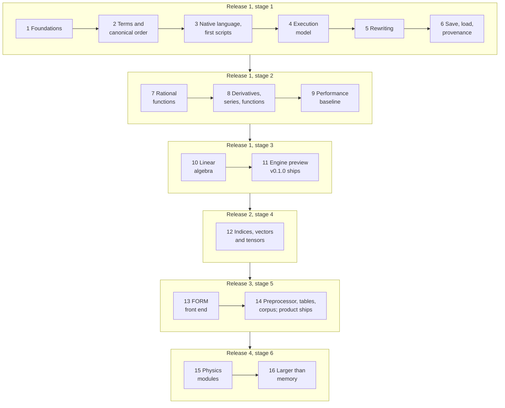

# Tante: Implementation roadmap
Draft | 11 November 2026 | Based on requirements v0.21

This document sets the order of the work: which release delivers which [requirements](requirements.md), in which phases, and what must be decided before each phase starts. **How** Tante is built is in the [architecture](architecture.md), **why** in the [ADRs](glossary.md#adr). Thomas decided the content on 11 November 2026, after a brief in chat, one decision at a time: who each release is for, the phases, where FORM's [preprocessor](glossary.md#preprocessor) and tables go, the target on [the FORM corpus](glossary.md#form-corpus), and when [expressions](glossary.md#expression) larger than memory arrive. <!-- glossary-ignore: target -->

## Principles

- **Risky foundations first.** The parts that can invalidate everything else are proven before anything depends on them: the build guardrails and the [module interface](glossary.md#module-interface) in phase 1, the [canonical order](glossary.md#canonical-order) by measurement in phase 2, a [store](glossary.md#store) on disk in the tests from phase 4.
- **Every phase ends with something runnable.** From phase 3 on, that is a script the command-line tool runs.
- **Open decisions are settled just before the phase that needs them**, not all up front. The Needs line of each phase lists them: open decisions of the requirements by their ID, records still to be written by their subject. The [table at the end](#open-decisions-by-phase) collects both.
- **Guardrails are checked automatically on every change.** Each phase adds tests for its requirements, tagged with their IDs ([REQ-072](requirements.md#req-072)), and its entries to [the corpus](glossary.md#corpus) ([REQ-070](requirements.md#req-070)). CI must pass before a pull request is merged ([development.md](development.md)).

## Releases and who they are for

The releases follow the six stages of [OPEN-K](requirements.md#open-k). The first release covers stages 1 to 3. Each later release adds one stage. <!-- glossary-ignore: stage -->

| Release | Stages | Who can do real work with it | What it does better than what exists |
|---|---|---|---|
| 1, engine preview (v0.1.0) | 1–3: polynomials, [rational functions](glossary.md#rational-function), linear algebra | Few users: polynomial, rational-function and linear-algebra work up to $10^6$ [terms](glossary.md#term), which FORM, Mathematica, Maple and SymPy already do | Qualities, not capability: byte-identical output whatever the threads or the platform, an order independent of declarations, provenance, a step trace, digits proven by [ball arithmetic](glossary.md#ball-arithmetic), native Windows |
| 2 | 4: indices and tensors | Generic tensor algebra in the native language | The same qualities |
| 3, the minimum viable product | 5: the FORM [front end](glossary.md#front-end) | FORM users whose scripts need no physics [module](glossary.md#module) | Their existing FORM scripts, with guarantees FORM lacks: no cap on the size of a term, [dollar variables](glossary.md#dollar-variable) that cannot silently change a result under threads, provenance, a step trace, native Windows |
| 4 | 6: physics modules; expressions larger than memory | The core audience: calculations with Dirac algebra, colour and GR tensors | Full capability with the same qualities |

<!-- glossary-ignore: stage, block -->

Stages 1 to 3 are not a minimum viable product for Tante's main users: their FORM scripts use indices and Dirac algebra from the first lines. The first release is therefore an **engine preview**. It is public, for validation and early feedback, and not announced. The **minimum viable product** is the third release, because a FORM group adopts a tool that runs its existing scripts ([REQ-020](requirements.md#req-020)). Tante is announced with it. The PyPI name `tante` is already reserved ([OPEN-A](requirements.md#open-a)). Thomas decided this on 11 November 2026, revising the wording of [OPEN-K](requirements.md#open-k). <!-- glossary-ignore: stage -->

Each box is a phase, grouped by the stage of [OPEN-K](requirements.md#open-k) it belongs to. The minimum viable product ships at the end of phase 14. <!-- glossary-ignore: stage -->

## Release 1: engine preview (v0.1.0)

### Phase 1: Foundations

The CMake and [vcpkg](glossary.md#vcpkg) skeleton with the [targets](glossary.md#target) of the [architecture](architecture.md#5-building-blocks). CI on Windows, macOS and Linux with warnings as errors, [sanitizers](glossary.md#sanitizer), [static analysis](glossary.md#static-analysis) and the docs check. `Integer` and `Rational` on [GMP](glossary.md#gmp), behind Tante's own interface. Both polynomial back ends, [FLINT](glossary.md#flint) and Tante's own, compared on the polynomial corpus entries. The guardrails of [ADR-0004](adr/0004-library-first-target-structure.md) point 5: the [include check](glossary.md#include-check), a build without FLINT, and the module SDK with the out-of-tree example module `examples/module-hello`, built and loaded by a test on all three systems. Runnable: the test suite and `tante --version`.

- Requirements: [REQ-018](requirements.md#req-018), [REQ-031](requirements.md#req-031), [REQ-032](requirements.md#req-032) (compiled modules), [REQ-050](requirements.md#req-050), [REQ-072](requirements.md#req-072), [REQ-074](requirements.md#req-074) (d), [REQ-096](requirements.md#req-096), [REQ-097](requirements.md#req-097), [REQ-098](requirements.md#req-098) (numbers of any size)
- Resolves: nothing
- Needs: nothing beyond the accepted [ADR-0001](adr/0001-cpp20-cmake-vcpkg-guardrails.md), [ADR-0003](adr/0003-flint-gmp-arb-behind-own-interfaces.md) and [ADR-0004](adr/0004-library-first-target-structure.md). The records below are written while this phase is built, each just before the phase that needs it.

### Phase 2: Terms, canonical order and the in-memory store

The term [view](glossary.md#view) and [builder](glossary.md#builder) of [ADR-0005](adr/0005-term-representation.md), the session's tables of names and properties, the in-memory store with its sort and merge, and the canonical order. The record on canonical order chooses between a [table of ranks](glossary.md#table-of-ranks) and [renumbering](glossary.md#renumbering) by measurement, since the architecture names a slow canonical order as a risk. [Block](glossary.md#block) kinds for indices, vectors and tensors are reserved ([REQ-017](requirements.md#req-017)). Runnable: a test builds $(a+b)^2 - (a-b)^2$ through the C++ [API](glossary.md#api), expands it and finds $4ab$, the same for any declaration order.

- Requirements: [REQ-012](requirements.md#req-012), [REQ-017](requirements.md#req-017) (design obligation), [REQ-054](requirements.md#req-054) (store interface), [REQ-074](requirements.md#req-074) (a), [REQ-098](requirements.md#req-098) ([long forms](glossary.md#long-form))
- Resolves: nothing
- Needs: the record on canonical order

### Phase 3: The native language and first scripts

The first scripts run from the command line: declarations, expansion, collection, substitution and truncation of high powers, printed as plain text and LaTeX, the text readable back as input. Undeclared names are errors. Errors name the line, the construct and what was expected. The tool calls only `tante_api`, which can run a script statement by statement with the same result as the whole script, so that the interactive session can be added later. The native language has no text preprocessor: loops, procedures, conditions and including other files are constructs of the language ([REQ-013](requirements.md#req-013)). The getting-started tutorial is written, with its examples run as tests. Runnable: `tante` runs a script file and prints its result.

- Requirements: [REQ-010](requirements.md#req-010) (expansion, collection, substitution), [REQ-013](requirements.md#req-013), [REQ-024](requirements.md#req-024), [REQ-057](requirements.md#req-057) (text and LaTeX), [REQ-060](requirements.md#req-060), [REQ-064](requirements.md#req-064), [REQ-091](requirements.md#req-091) (getting started), [REQ-093](requirements.md#req-093) (truncation)
- Resolves: [OPEN-R](requirements.md#open-r)
- Needs: [OPEN-R](requirements.md#open-r); the record on the native language (statements, declarations, how a script reads close to paper); the record on errors

### Phase 4: Execution model, threads and the step trace

Statements are grouped into passes over the terms. A [stage](glossary.md#stage) ends with a sort and merge. Terms are processed by several threads with output identical for 1, 2 and 8 threads on all three systems. [Checkpoints](glossary.md#checkpoint) record the expression. The named steps between them are traced. Batch runs write to files, return a non-zero exit status on failure and use temporary directories unique per job. Running out of memory or disk names which, and at which statement. A minimal store on disk proves the store interface: it writes sorted runs of terms to temporary files and merges them, as FORM does. It is selectable only by the tests, with no resuming and no tuning. CI runs every test that uses a store against both stores. Runnable: a script with checkpoints prints its trace, on 1 and 8 threads.

- Requirements: [REQ-040](requirements.md#req-040), [REQ-051](requirements.md#req-051), [REQ-052](requirements.md#req-052), [REQ-054](requirements.md#req-054) (proven in the tests), [REQ-074](requirements.md#req-074) (a) and (b), [REQ-098](requirements.md#req-098)
- Resolves: nothing
- Needs: the record on the execution model

### Phase 5: Pattern-based rewriting and script modules

Patterns with [wildcards](glossary.md#wildcard), conditions, rules applied repeatedly until no match remains, and the documented choice among several matches. Script modules, written in the native language as declarations and rules, are loaded by name or path. Runnable: a script module of rules, loaded by a script.

- Requirements: [REQ-011](requirements.md#req-011), [REQ-030](requirements.md#req-030), [REQ-032](requirements.md#req-032) (script modules), [REQ-074](requirements.md#req-074) (c)
- Resolves: nothing
- Needs: the record on pattern matching

### Phase 6: Saving, loading and provenance

The versioned binary save format, byte-identical on all three systems. A result written to a file is accompanied by its provenance, kept apart from the result. The state of a calculation can be saved between stages, so that resuming can be added with expressions larger than memory. This completes stage 1 of [OPEN-K](requirements.md#open-k). Runnable: one script saves an expression and a second loads it. <!-- glossary-ignore: stage -->

- Requirements: [REQ-055](requirements.md#req-055) (design obligation), [REQ-075](requirements.md#req-075), [REQ-100](requirements.md#req-100)
- Resolves: nothing
- Needs: the record on the binary save format

### Phase 7: Rational functions and factorisation

[Polynomial greatest common divisors](glossary.md#polynomial-greatest-common-divisor), factorisation over the rational numbers, checked by multiplying the factors back, and normalised rational functions as [`RATFUN`](glossary.md#ratfun) [coefficients](glossary.md#coefficient). Both polynomial back ends are compared on the rational-function corpus entries. Properties of symbols can be declared. Runnable: a script simplifies a rational function and factorises its denominator.

- Requirements: [REQ-010](requirements.md#req-010) (greatest common divisor, factorisation, rational functions), [REQ-071](requirements.md#req-071), [REQ-094](requirements.md#req-094), [REQ-097](requirements.md#req-097)
- Resolves: nothing
- Needs: nothing

### Phase 8: Derivatives, series and elementary functions

Differentiation, Taylor and [Laurent series](glossary.md#laurent-series), the elementary functions as a module using only the module interface, and numerical evaluation to a chosen precision, every printed digit proven. Runnable: a script expands $\exp(\varepsilon x)$ to order $\varepsilon^3$ and evaluates $\exp(1)$ to 30 digits.

- Requirements: [REQ-010](requirements.md#req-010) (differentiation), [REQ-018](requirements.md#req-018), [REQ-093](requirements.md#req-093) (series), [REQ-099](requirements.md#req-099), [REQ-101](requirements.md#req-101)
- Resolves: nothing
- Needs: nothing

### Phase 9: Performance baseline

A [spike](glossary.md#spike) measures FORM 5.0.2 and [TFORM](glossary.md#tform) on the [reference machine](glossary.md#reference-machine): the benchmarks of kind (A) and (B) of [REQ-056](requirements.md#req-056), using polybench without its Symbolica column ([ADR-0002](adr/0002-no-input-from-symbolica.md)). It sets the factors and thread speed-ups of [OPEN-F](requirements.md#open-f). The performance acceptance tests then run in CI: the factors against FORM, the speed-up on 2 and 4 threads, $10^6$ terms in 16 GB and the cost of tracing when it is off. The repository must be public before this phase, since the reference machine is the 4-CPU runner GitHub offers public repositories. Runnable: the benchmarks, with their factors published in the CI summary.

- Requirements: [REQ-040](requirements.md#req-040) (cost of tracing), [REQ-052](requirements.md#req-052) (speed-up), [REQ-053](requirements.md#req-053), [REQ-056](requirements.md#req-056)
- Resolves: [OPEN-F](requirements.md#open-f) (by spike)
- Needs: [OPEN-F](requirements.md#open-f), settled by the spike at the start of the phase; the repository public ([OPEN-G](requirements.md#open-g))

### Phase 10: Linear algebra

The linear-algebra module, built only on the module interface: matrices with symbolic entries, products, transposes, determinants, inverses, rank and null space, and the solution of linear systems, each result with the conditions under which it holds. Runnable: a script finds the rank of $\begin{pmatrix} a & 1 \\ 1 & a \end{pmatrix}$ as 2, valid for $a^2 - 1 \neq 0$.

- Requirements: [REQ-014](requirements.md#req-014), [REQ-030](requirements.md#req-030) (acceptance)
- Resolves: nothing
- Needs: nothing

### Phase 11: The engine preview

The release itself. The first-release corpus is complete and every entry is cross-checked against an independent source. A traceability report lists each SHALL requirement as passing, failing, manual or not covered. The manual-verification list holds what cannot be automated. The user documentation (tutorials from the corpus, a reference entry for every statement and function) and the maintainer documentation (building, testing, writing a module) are complete. The contributing guide says that outside contributions are not accepted, and how to fork. The measured factors against FORM are published.

- Requirements: [REQ-005](requirements.md#req-005), [REQ-050](requirements.md#req-050) (identical output on all three systems), [REQ-056](requirements.md#req-056) (published factors), [REQ-070](requirements.md#req-070), [REQ-071](requirements.md#req-071), [REQ-072](requirements.md#req-072), [REQ-080](requirements.md#req-080), [REQ-090](requirements.md#req-090), [REQ-091](requirements.md#req-091), [REQ-092](requirements.md#req-092)
- Resolves: nothing
- Needs: nothing

### What the engine preview ships

Stages 1 to 3 of [OPEN-K](requirements.md#open-k), run from the command line on Windows, macOS and Linux. Not yet in it, by Thomas's decision of 11 November 2026: the interactive session ([REQ-060](requirements.md#req-060)), designed in and added in a later release; exact roots by radicals ([REQ-015](requirements.md#req-015)), a later release; export as C or Fortran code ([REQ-057](requirements.md#req-057)), with the FORM front end in release 3. The store on disk exists only in the tests. <!-- glossary-ignore: stage -->

## Release 2: indices and tensors

### Phase 12: Indices, vectors and tensors

Indices with a declared dimension, which may be a symbol such as $d$; vectors; functions and tensors with declared symmetry and commutation; contraction of repeated indices; and a tensor canonicaliser behind an interface of Tante's own. The reuse of xPerm is decided by ADR at the start of the phase, after its licence version is checked. The FORM corpus is not run yet, so this release sets no target on it. Runnable: a script contracts $g_{\mu\nu} g^{\nu\rho}$ to $\delta_\mu^\rho$ in $d$ dimensions.

- Requirements: [REQ-017](requirements.md#req-017), [REQ-096](requirements.md#req-096) (the canonicaliser)
- Resolves: [OPEN-O](requirements.md#open-o) (b) (by ADR)
- Needs: [OPEN-O](requirements.md#open-o) (b); the contraction of indices, if the record on pattern matching has not settled it

## Release 3: the minimum viable product

### Phase 13: The FORM front end

A compatibility specification, subordinate to the requirements, is written first. It records the build of [the reference](glossary.md#reference) (FORM 5.0.2 with FLINT, as `form -vv` reports it) and lists the supported statements. Then `tante_form`: declarations, expressions, `.sort` stages, `id` statements with wildcards, dollar variables with their declared reduction, FORM's `save` and `load`, and printing in FORM's syntax. Export as C or Fortran code, with common subexpressions factored out, arrives here, since generated code is how FORM results usually leave FORM. Expressions from either front end are the same kind of object. Runnable: FORM's manual examples that need no preprocessor run and agree with FORM.

- Requirements: [REQ-020](requirements.md#req-020), [REQ-022](requirements.md#req-022), [REQ-023](requirements.md#req-023), [REQ-025](requirements.md#req-025), [REQ-057](requirements.md#req-057) (export), [REQ-074](requirements.md#req-074) (b)
- Resolves: nothing
- Needs: the compatibility specification ([OPEN-D](requirements.md#open-d))

### Phase 14: Preprocessor, tables and the FORM corpus

FORM's preprocessor with FORM's textual meaning, inside `tante_form` only: `#define` and `#redefine`, `#do`, `#if` and `#else`, `#procedure` and `#call`, `#include`, `#write` and `#message`. Every other directive (`#external`, `#system`, dictionaries and the rest) stops with the error of [REQ-020](requirements.md#req-020). FORM expands a script one module at a time, after the previous module has run, so the preprocessor can use the values of dollar variables. A record on the FORM preprocessor decides how its expansion interleaves with execution. Tables: `Table`, `CTable` and `Fill`. Tablebases, FORM's tables on disk, arrive with expressions larger than memory in phase 16. The guide for FORM users maps FORM constructs to native ones. The FORM corpus is added to the benchmarks.

The release's acceptance test on the FORM corpus (Thomas, 11 November 2026, [OPEN-D](requirements.md#open-d)):

- **Target:** at least 80 % of the corpus agrees with FORM, that is 303 of its 378 scripts.
- **No wrong results:** every script either agrees with FORM or stops with the error of [REQ-020](requirements.md#req-020) naming the unsupported statement. This holds for all of them.
- **Counting:** a script that FORM's own suite skips for the reference build leaves the denominator. A test that expects FORM to reject its input agrees when Tante also stops with an error, whatever the message. Only results are compared, in [canonical form](glossary.md#canonical-form), never layout or byte sizes.

Evidence: of 376 scripts counted in FORM 5.0.2's `check/examples.frm` and `check/fixes.frm` on 11 November 2026, 77 use a preprocessor directive beyond listing control, 10 use tables and 8 use Dirac algebra. Without the preprocessor, at most 77 % would be reachable.

- Requirements: [REQ-020](requirements.md#req-020), [REQ-021](requirements.md#req-021), [REQ-056](requirements.md#req-056) (FORM corpus in the benchmarks), [REQ-091](requirements.md#req-091) (guide for FORM users)
- Resolves: nothing
- Needs: the record on the FORM preprocessor

## Release 4: physics and scale

### Phase 15: Physics modules

The physics modules of [REQ-033](requirements.md#req-033), in the order of [OPEN-K](requirements.md#open-k): Dirac algebra first, then GR tensors, spinor-helicity and colour algebra. Each module declares its conventions and their defaults, recorded with every result. Each module's corpus entries become tutorials. The release raises the target on the FORM corpus, set when the release is planned.

- Requirements: [REQ-033](requirements.md#req-033), [REQ-034](requirements.md#req-034), [REQ-070](requirements.md#req-070), [REQ-091](requirements.md#req-091)
- Resolves: nothing
- Needs: nothing ([OPEN-I](requirements.md#open-i) is resolved)

### Phase 16: Expressions larger than memory

The store on disk of phase 4, made selectable by users, with tuning but no limits fixed in advance. Resuming an interrupted run, tested as rigorously as any result. Tablebases. A larger CI runner, since the reference machine's 14 GB of disk does not hold such calculations ([OPEN-G](requirements.md#open-g)).

- Requirements: [REQ-054](requirements.md#req-054), [REQ-055](requirements.md#req-055), [REQ-098](requirements.md#req-098)
- Resolves: nothing
- Needs: nothing

## Later, not yet placed

These are revisited when release 3 ships. Placing them now would be a guess.

- The C++ library, the Python package and notebooks ([REQ-061](requirements.md#req-061) to [REQ-063](requirements.md#req-063)). Python and notebooks are the strongest candidates, since they serve researchers and learners.
- The learner's explanations ([REQ-003](requirements.md#req-003)).
- The interactive session ([REQ-060](requirements.md#req-060)) and exact roots by radicals ([REQ-015](requirements.md#req-015)).
- Differential equations ([REQ-016](requirements.md#req-016)), limits ([REQ-095](requirements.md#req-095)), special functions such as $\Gamma$ ([REQ-099](requirements.md#req-099)).
- A tool that translates FORM scripts into the native language, as a migration aid. Tidy uses of the preprocessor become native loops and procedures. What it cannot translate faithfully it reports instead of guessing. FORM scripts are always run by the FORM front end, never through this translation ([REQ-020](requirements.md#req-020)).

## Open decisions by phase

| Decision | Needed before | Settled by |
|---|---|---|
| Record on canonical order | [Phase 2](#phase-2-terms-canonical-order-and-the-in-memory-store) | ADR, with a measurement |
| Record on the native language | [Phase 3](#phase-3-the-native-language-and-first-scripts) | ADR |
| Record on errors | [Phase 3](#phase-3-the-native-language-and-first-scripts) | ADR |
| [OPEN-R](requirements.md#open-r): examples that are tests | [Phase 3](#phase-3-the-native-language-and-first-scripts) | Requirements pass |
| Record on the execution model | [Phase 4](#phase-4-execution-model-threads-and-the-step-trace) | ADR |
| Record on pattern matching | [Phase 5](#phase-5-pattern-based-rewriting-and-script-modules) | ADR |
| Record on the binary save format | [Phase 6](#phase-6-saving-loading-and-provenance) | ADR |
| [OPEN-F](requirements.md#open-f): numbers for scale and performance | [Phase 9](#phase-9-performance-baseline) | Spike |
| [OPEN-O](requirements.md#open-o) (b): reuse of xPerm | [Phase 12](#phase-12-indices-vectors-and-tensors) | ADR |
| Compatibility specification ([OPEN-D](requirements.md#open-d)) | [Phase 13](#phase-13-the-form-front-end) | Document |
| Record on the FORM preprocessor | [Phase 14](#phase-14-preprocessor-tables-and-the-form-corpus) | ADR |

The docs check verifies the rows with an OPEN ID: each open decision's Needed by note in the requirements names the phase whose Needs line lists it. It cannot check the records, which are tracked by this table and the [architecture's list](architecture.md#10-decisions).
