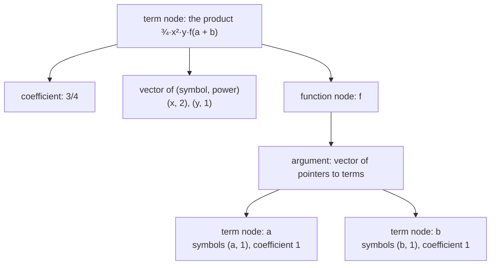
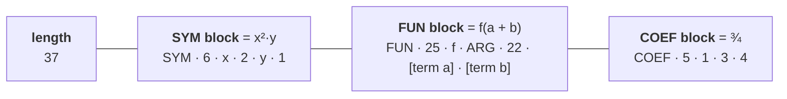
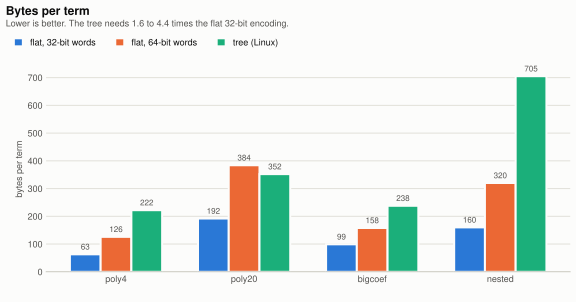
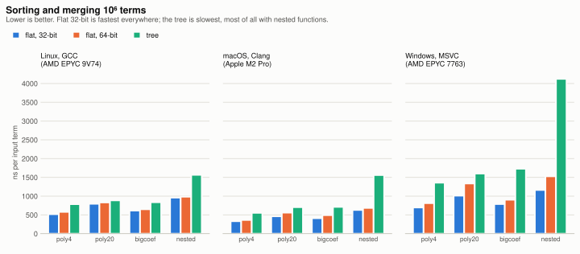
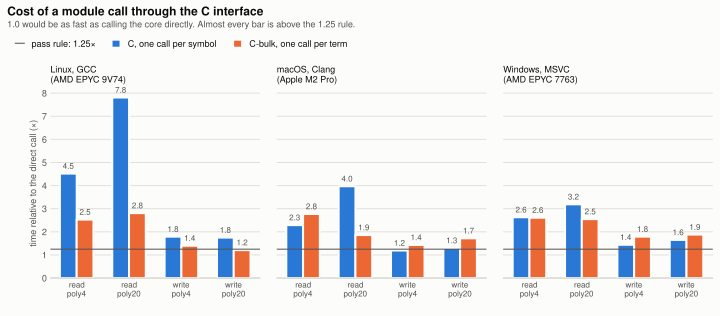

# Spike: a flat, pointer-free term encoding with 32-bit words is smaller and sorts faster than 64-bit words or a tree, and a module call through the C interface costs 1.2 to 1.8 times a direct call when it rewrites a term

Date: 21 October 2026 | For: [ADR-0005](../adr/0005-term-representation.md), [ADR-0004](../adr/0004-library-first-target-structure.md) (Consequences), [REQ-054](../requirements.md#req-054), [REQ-056](../requirements.md#req-056), [REQ-074](../requirements.md#req-074), [REQ-098](../requirements.md#req-098)

## Terms used

- **Canonical order**: the one fixed order in which the engine writes the factors inside a [term](../glossary.md#term) and the terms of an [expression](../glossary.md#expression), so that two equal expressions are stored and printed identically ([REQ-012](../requirements.md#req-012)). For example, `y·x` and `x·y` are both stored as `x·y`, and `b + a` and `a + b` both as `a + b`. The record on canonical order fixes the real rules; this [spike](../glossary.md#spike) uses a simple stand-in.
- **Table of ranks**: symbols get numbers in the order a script creates them, but [REQ-012](../requirements.md#req-012) requires the order to depend on their names. So the engine keeps an array, indexed by symbol number, giving the position of each symbol's name in alphabetical order. For a script that creates `z`, `a` and `m`, in that order:

  | symbol | number (creation order) | rank (alphabetical order) |
  |---|---|---|
  | `z` | 0 | 2 |
  | `a` | 1 | 0 |
  | `m` | 2 | 1 |

  Comparing two symbols then means comparing `rank[i]` with `rank[j]`, one array lookup each, instead of `i` with `j`. In .NET terms, it is like `OrderBy(id => rank[id])` instead of `OrderBy(id => id)`.
- **Limb**: one word-sized digit of a large number. A 96-digit integer takes ten 32-bit limbs or five 64-bit limbs.
- **Hash-consing**: *cons* is Lisp's word for building a node. A hash-consing engine keeps a hash table of every node it has built. Before building a new node, it looks for an equal one and returns that instead, so every distinct subexpression exists once and is shared. It is like `string.Intern` in .NET. It saves memory when subexpressions repeat, and costs a lookup in a global table for every node built. <!-- glossary-ignore: word -->
- **Allocator rounding**: the heap hands out memory in a fixed set of block sizes, in steps of 16 bytes on these three systems, so that any type stored in a block is correctly aligned. A request for 20 bytes gets a 24- or 32-byte block, and the rest of the block cannot be used for anything else. The unit is bytes, not bits: nothing smaller than a byte can be allocated. The allocator also keeps a few bytes of bookkeeping per block, which the spike's figures leave out. <!-- glossary-ignore: block -->
- **FNV-1a** (Fowler–Noll–Vo): a small, fast hash function. The spike prints each result as text and hashes the text to a 64-bit fingerprint; equal fingerprints mean equal printed results, the way two files are compared by their checksums. It is not secure against collisions made on purpose, which does not matter here.
- **Inlining**: the compiler copies a function's body into its caller, so no call happens at run time. It is impossible across a shared-library boundary, because the compiler of one side never sees the other side's code.

## Question

Before the record on term representation fixes how a term is stored (Thomas, 21 October 2026: a flat encoding, 32-bit [words](../glossary.md#word), [opaque handles](../glossary.md#opaque-handle) for [modules](../glossary.md#module)):

1. How many bytes does a term take in a flat encoding with 32-bit words, with 64-bit words, and as a tree of reference-counted nodes?
2. How long does it take to sort an expression and add the [coefficients](../glossary.md#coefficient) of equal terms in each? How much does it cost to compare symbols through a table of ranks by name rather than by their numbers, as canonical order independent of declaration order requires ([REQ-012](../requirements.md#req-012))?
3. What does it cost per term to call a module function through the C [module interface](../glossary.md#module-interface), compared with calling the same code directly? Rule fixed before the run (brief of 20 October 2026): if the C call is within 1.25 times the direct call, [ADR-0004](../adr/0004-library-first-target-structure.md)'s second wrapper implementation is not built yet.

## Method

The code lives on the branch `spike/term-representation`, which is kept and not merged. Final state: commit [`fc7f28a`](https://github.com/thomaswening/Tante/tree/fc7f28a320d8ce9c941f8aa218fe67626c1e5e82/docs/spikes/2026-10-21-term-representation). It uses only the C++ standard library, so the CI jobs need no [vcpkg](../glossary.md#vcpkg).

### The two representations, on one example

The term ¾·x²·y·f(a + b) has three parts: a coefficient, symbols with powers, and a function whose single argument is itself an expression of two terms.

```
   ¾     ·     x² · y     ·     f(a + b)
 coefficient   symbols          function, whose argument is the expression a + b
```

**As a tree** (the baseline): every box is a separate object on the heap and every arrow a pointer, so the term is scattered over memory. Like a graph of C# class instances, each with references to the next.



The root is the term itself, the product of its parts; none of the three parts is the root, and no rule ranks one above the others. The coefficient is drawn as a child of the product here. In the spike's code, as in GiNaC's product node, the coefficient is stored inside the product node rather than in a node of its own, because it is a plain number that every product has.

**Flat** (the encoding measured): the same term is one contiguous block of 37 words with no pointers. Each part of the expression becomes one block, and every block starts with its kind and its own length: <!-- glossary-ignore: block -->



The lines mean "followed in memory by". Inside the argument, each of `a` and `b` is a complete term of 10 words, encoded the same way: `[10] [SYM · 4 · a · 1] [COEF · 5 · 1 · 1 · 1]`. In the `COEF` block, the third word says how many limbs the numerator has (here 1); the numerator and denominator limbs follow. Both can be large integers. The denominator's limb count is not stored because the block's length already fixes it: denominator limbs = block length − 3 − numerator limbs, here 5 − 3 − 1 = 1.

The general shape is `[length] [SYM block]? [FUN block]* [COEF block]`. As in regular expressions, `?` means zero or one and `*` means zero or more: a term has exactly one length word, at most one `SYM` [block](../glossary.md#block) (none if it has no symbols), any number of `FUN` blocks, and exactly one `COEF` block. Because every block states its length, a reader can skip a block it does not handle.

### What was measured

- **The encoding** ([`main.cpp`](https://github.com/thomaswening/Tante/blob/fc7f28a320d8ce9c941f8aa218fe67626c1e5e82/docs/spikes/2026-10-21-term-representation/main.cpp)), as drawn above. `SYM` holds (symbol, power) pairs in canonical order; `FUN` holds a function number and its arguments, each an expression of complete terms; `COEF` holds a rational number as limbs. The same code is compiled with 32-bit and 64-bit words.
- **The tree baseline**, as drawn above. Each term node is allocated with `std::make_shared`; it holds vectors of (symbol, power) pairs, functions whose arguments are vectors of shared pointers to terms, and the coefficient as vectors of 64-bit limbs. It is a plain tree, as in GiNaC or SymEngine without their hash-consing. Its size is the heap memory in use as the allocator rounds it (`malloc_usable_size`, `malloc_size`, `_msize`), plus 16 bytes for the pointer in the expression's array.
- **Workloads**, generated deterministically (SplitMix64), 10⁶ terms each. The example terms show the shape; the numbers are illustrative.

  | Workload | What varies | Example term |
  |---|---|---|
  | `poly4` | 4 symbols `x, y, z, w`, powers 0 to 31 (power 0 leaves the symbol out), coefficients up to 2²⁰. A third of the terms merge with another. | `734821 · x³ · z¹⁷ · w⁵` |
  | `poly20` | 20 of the 40 symbols `s0` to `s39`, powers 1 to 3. No merges. | `5213 · s0² · s3 · s4³ · s7 · …` (20 symbols) |
  | `bigcoef` | as `poly4`, with coefficients of about 96 decimal digits | `30591207…448113 · x⁹ · y · z²` |
  | `nested` | as `poly4` with powers 0 to 7, times one function `f0` or `f1` whose argument has two terms, each one of the symbols `a, b, c, d` | `12345 · x² · w⁷ · f1(2·a + 3·c²)` |

  `poly4` was also run with 10⁷ terms in the two flat encodings.
- **Sorting.** All terms of an expression sit one after another in one large buffer of words. An *offset* is the position in that buffer where a term starts, so an *array of offsets* is an index of the terms: `[0, 16, 37, …]` says the first term starts at word 0, the second at word 16, and so on. Sorting reorders this small array with `std::sort` instead of moving the terms themselves, which would mean copying many words; FORM sorts pointers to terms for the same reason. In .NET terms, it is `Array.Sort(offsets, comparer)`, where the comparer looks both terms up in the buffer.

  After sorting, terms with the same factors stand next to each other, whatever their coefficients. Such a group is a *run*, and the merge writes each run as one term whose coefficient is the sum (illustrative numbers):

  ```
  sorted:   3·x²·y   5·x²·y   1·x²·y   2·x·y³   7·z
            └─────── one run ──────┘
  merged:   9·x²·y   2·x·y³   7·z
  ```

  The order is the spike's stand-in for canonical order: symbols, then functions, then (inside arguments) coefficients. Symbols are compared either by their number ("id") or through a table of ranks ("rank"). The record on canonical order decides the real one.
- **The module call** ([`spike_module.h`](https://github.com/thomaswening/Tante/blob/fc7f28a320d8ce9c941f8aa218fe67626c1e5e82/docs/spikes/2026-10-21-term-representation/spike_module.h), [`module.cpp`](https://github.com/thomaswening/Tante/blob/fc7f28a320d8ce9c941f8aa218fe67626c1e5e82/docs/spikes/2026-10-21-term-representation/module.cpp), [`module_logic.hpp`](https://github.com/thomaswening/Tante/blob/fc7f28a320d8ce9c941f8aa218fe67626c1e5e82/docs/spikes/2026-10-21-term-representation/module_logic.hpp)). The module's own code (`module_logic.hpp`) is written once against a small C++ [API](../glossary.md#api): `symbol_count()` and `symbol_at(i)` to read a term, and `begin()`, `add_symbol(s, p)`, `copy_rest(term)` and `end()` to write one. The **wrapper** is whatever class implements that API. In .NET terms, the module code is a generic method constrained on an interface, and the wrapper is the struct that implements it. The spike has three wrappers, so the same module code runs three ways. It runs two functions on every term of `poly4` and `poly20`:
  - *read*: the sum of the powers of the symbols;
  - *write*: multiply the term by a symbol, giving a new term through the engine's [builder](../glossary.md#builder).

  ```mermaid
  flowchart TB
      subgraph D["direct: module code compiled into the engine"]
          E1["engine loop over terms"] -->|"inlined: no call at all"| W1["module code reads<br/>and writes the words itself"]
      end
      subgraph C["C: module in a shared library, one call per symbol"]
          E2["engine loop over terms"] -->|"1 call per term"| M2["module function"]
          M2 -->|"1 call for the count,<br/>then 1 call per symbol read<br/>and 1 per symbol written"| H2["engine's C functions"]
      end
      subgraph B["C-bulk: module in a shared library, one call per term"]
          E3["engine loop over terms"] -->|"1 call per term"| M3["module function"]
          M3 -->|"1 call copies all symbols out;<br/>1 call writes the new term"| H3["engine's C functions"]
      end
  ```

  Calls made for one `poly4` term with 4 symbols:

  | Path | *read* | *write* | What it stands for |
  |---|---|---|---|
  | direct | 0 | 0 | [ADR-0004](../adr/0004-library-first-target-structure.md)'s second wrapper: a built-in module compiled with the core |
  | C | 6 | 13 or 14 | a third-party module using the [C interface](../glossary.md#c-interface) as decided in [ADR-0004](../adr/0004-library-first-target-structure.md) |
  | C-bulk | 2 | 3 | a variant of the C interface with bulk accessors, tried as a possible remedy |

  The *write* count is 1 to enter the module, 1 for the count, 4 reads, `begin`, 4 or 5 `add_symbol` calls (5 when the symbol is new to the term), `copy_rest` and `end`.

  The difference between C and C-bulk, on reading the term `x³·z¹⁷·w⁵`:

  ```
  C, one call per symbol                       C-bulk, one call per term
  symbol_count()  -> 3                         term_symbols(buffer) -> 3,
  symbol_at(0)    -> (x, 3)                        buffer = (x, 3) (z, 17) (w, 5)
  symbol_at(1)    -> (z, 17)
  symbol_at(2)    -> (w, 5)                    then reads its own buffer, no calls
  4 calls into the engine                      1 call into the engine
  ```

  In .NET terms, it is the difference between a chatty interface (one call per property across a boundary) and a chunky one (one call that returns everything).
- **Checks.** Every representation prints its result in one text form, and the program fails unless the following give the same FNV-1a digest:
  - the 32-bit, 64-bit and tree sorts;
  - the direct and C calls.

  `results.txt` (sizes, term counts, digests) must be byte-identical on all three systems.
- **Workflow** ([`spike-term-representation.yml`](https://github.com/thomaswening/Tante/blob/fc7f28a320d8ce9c941f8aa218fe67626c1e5e82/.github/workflows/spike-term-representation.yml)): `windows-latest` ([MSVC](../glossary.md#msvc) 19.51), `ubuntu-latest` ([GCC](../glossary.md#gcc) 13.3), `macos-latest` (Apple Clang 21) on 2-vCPU (Windows, Linux) and 5-vCPU (macOS) virtual machines. Each job records the CPU, builds in Release, runs the full sizes (medians of 5 repetitions, 3 for 10⁷ terms), then builds with [sanitizers](../glossary.md#sanitizer) and runs small sizes. A final job compares `results.txt`. The C++20 warning flags of [ADR-0001](../adr/0001-cpp20-cmake-vcpkg-guardrails.md) §3 are errors.

Runs:
- [39511353324](https://github.com/thomaswening/Tante/actions/runs/39511353324): all checks passed. The comparison failed only because Windows wrote line endings as CRLF; fixed by writing files in binary mode.
- [39512169279](https://github.com/thomaswening/Tante/actions/runs/39512169279): green, but the bulk path zero-filled a 512-byte buffer on every term, which made it slower than the fine-grained path. This was a fault of the spike, not of the approach.
- [39512843746](https://github.com/thomaswening/Tante/actions/runs/39512843746): green. The tables below are from this run.

All three runs gave byte-identical `results.txt` on all three systems.

## Result

The charts are drawn by [`charts.py`](2026-10-21-term-representation/charts.py) from the numbers of run 3; the tables give every value.

**1. Bytes per term.** The flat sizes are exact and identical everywhere. The tree's are heap bytes as each system's allocator rounds them (Linux / macOS / Windows), plus 16 bytes of pointer.

<picture>
  <source media="(prefers-color-scheme: dark)" srcset="2026-10-21-term-representation/bytes-per-term-dark.svg">
  
</picture>

| Workload | flat, 32-bit | flat, 64-bit | tree | tree ÷ flat 32 |
|---|---|---|---|---|
| `poly4` | 63 | 126 | 222 / 208 / 175 | 2.8–3.5 |
| `poly20` | 192 | 384 | 352 / 336 / 304 | 1.6–1.8 |
| `bigcoef` | 99 | 158 | 238 / 240 / 207 | 2.1–2.4 |
| `nested` | 160 | 320 | 705 / 655 / 532 | 3.3–4.4 |

64-bit words double every term except where a large coefficient fills its words anyway (`bigcoef`, 1.6 times). The tree makes 4 allocations per plain term and 17 per nested term.

**2. Sorting and merging**, ns per input term, 10⁶ terms (10⁷ in the last row). The 64-bit and tree columns show their time relative to flat 32-bit with ranks.

<picture>
  <source media="(prefers-color-scheme: dark)" srcset="2026-10-21-term-representation/sort-time-dark.svg">
  
</picture>

| Workload | System (runner's CPU) | flat 32, id | flat 32, rank | flat 64, rank | tree, rank |
|---|---|---|---|---|---|
| `poly4` | Linux (EPYC 9V74) | 501 | 519 | 581 (1.12) | 786 (1.51) |
| | macOS (M2 Pro) | 316 | 332 | 365 (1.10) | 555 (1.67) |
| | Windows (EPYC 7763) | 626 | 697 | 813 (1.17) | 1358 (1.95) |
| `poly20` | Linux | 738 | 796 | 832 (1.05) | 888 (1.12) |
| | macOS | 430 | 464 | 560 (1.21) | 706 (1.52) |
| | Windows | 922 | 1013 | 1337 (1.32) | 1601 (1.58) |
| `bigcoef` | Linux | 617 | 615 | 651 (1.06) | 837 (1.36) |
| | macOS | 396 | 412 | 493 (1.20) | 714 (1.73) |
| | Windows | 746 | 789 | 905 (1.15) | 1729 (2.19) |
| `nested` | Linux | 938 | 960 | 985 (1.03) | 1567 (1.63) |
| | macOS | 557 | 632 | 686 (1.09) | 1561 (2.47) |
| | Windows | 1187 | 1165 | 1529 (1.31) | 4124 (3.54) |
| `poly4`, 10⁷ | Linux / macOS / Windows | 651 / 490 / 1043 | 666 / 553 / 1112 | 725 / 566 / 1282 | — |

The CPUs are those of GitHub's virtual machines: AMD EPYC 9V74 and EPYC 7763 are AMD server processors; Apple M2 Pro is Apple's ARM processor. Which one a job gets varies between runs (see *Noise* below).

- 32-bit words sort faster than 64-bit words in every case, by 2 to 32 %.
- The tree is slower in every case, by 12 % to 3.5 times. The gap is widest with nested functions and on Windows.
- Comparing symbols through the rank table costs between −2 % and +13 % against comparing their numbers, typically 5 %.

**3. Module call**, ns per term (C or C-bulk ÷ direct in brackets):

<picture>
  <source media="(prefers-color-scheme: dark)" srcset="2026-10-21-term-representation/call-cost-dark.svg">
  
</picture>

| Function | System | direct | C, per symbol | C-bulk, per term |
|---|---|---|---|---|
| read, `poly4` | Linux / macOS / Windows | 4.3 / 2.6 / 4.9 | 19.4 (4.5) / 6.0 (2.3) / 13.0 (2.6) | 10.9 (2.5) / 7.2 (2.8) / 12.9 (2.6) |
| read, `poly20` | | 9.0 / 4.9 / 14.4 | 70.1 (7.8) / 19.6 (4.0) / 45.9 (3.2) | 25.3 (2.8) / 9.2 (1.9) / 36.7 (2.6) |
| write, `poly4` | | 28.8 / 26.1 / 53.4 | 51.6 (1.79) / 30.9 (1.19) / 77.0 (1.44) | 40.2 (1.40) / 37.2 (1.43) / 95.7 (1.79) |
| write, `poly20` | | 116 / 116 / 182 | 203 (1.75) / 151 (1.30) / 300 (1.65) | 140 (1.21) / 200 (1.72) / 342 (1.88) |

- **By the rule fixed in advance, the C interface fails.** Rewriting a term costs 1.19 to 1.79 times the direct call, and reading costs 2.3 to 7.8 times. Only macOS on `poly4` stays within 1.25.
- In absolute terms, the extra cost of rewriting is 5 to 118 ns per term. That is 1 to 12 % of the time the same terms take to be sorted once (330 to 1170 ns per term). So a statement that rewrites every term is slowed by roughly that much.
- Reading everything in one call per term helps on Linux, but does not do so consistently on macOS or Windows. It does not close the gap.

**Sanitizers.** AddressSanitizer and UndefinedBehaviorSanitizer (Linux, macOS) and AddressSanitizer (Windows) found nothing at the small sizes, and all checks passed.

**Noise.** The Linux runner had a different CPU in each run: Xeon 8573C, EPYC 7763, EPYC 9V74. `poly4` flat 32-bit with ranks took 457, 666 and 519 ns per term. On Windows, with the same CPU in all three runs, it took 592, 690 and 697. One outlier: Windows' first 10⁷-term sort in run 1 took 1624 ns, against 855 for the next. Differences under about 15 % within one run, and 30 % between runs, should not be read as real.

## Not tested

- **The real canonical order.** The spike's order is a stand-in; the record on canonical order may compare more fields, or compare them differently.
- **Real coefficients.** All coefficients were positive integers added with the spike's own limb arithmetic. There were no negative numbers or denominators, and no [GMP](../glossary.md#gmp). Rational arithmetic will add the same cost in every representation, so it narrows the ratios but does not reverse them.
- **A tree with hash-consing or a pool allocator.** Sharing equal subterms would shrink trees with repeated arguments, and a pool allocator would make allocation cheaper. Neither removes the pointers that rule a tree out for [REQ-054](../requirements.md#req-054).
- **Index and tensor objects** ([REQ-017](../requirements.md#req-017)): their sizes and comparison costs were not measured.
- **Threads, disk and FORM.** The sorts ran on one thread in memory. Nothing here is a comparison with FORM; the performance spike of [OPEN-F](../requirements.md#open-f) does that.
- **Realistic module functions.** Both functions were trivial on purpose: the cost of a call matters most when the work inside it is small. A module doing real work per term (pattern matching, trace algebra) pays the same fixed cost on a larger base.
- **Error handling across the boundary** (status codes, exceptions caught in the wrapper) was not in the measured path.
- **A better bulk interface.** The bulk path still copies each symbol twice and builds the term through the same builder. A design that lets the module write words straight into an engine buffer was not tried, because it would put the encoding in the C contract, which decision 4 of the brief excluded.

## Conclusion

- **Flat beats tree, and 32-bit words beat 64-bit.** The flat 32-bit encoding is 1.6 to 4.4 times smaller than the tree and sorts 1.1 to 3.5 times faster. 64-bit words double the size and sort 2 to 32 % slower, with no gain to set against that. Both choices from the brief stand.
- **The rank table costs about 5 %.** Canonical order by name ([REQ-012](../requirements.md#req-012)) is affordable. The record on canonical order decides whether to pay it on every comparison or to renumber symbols in name order at each sort.
- **The pass rule fails, so the direct wrapper comes now.** A call through the C interface costs 1.2 to 1.8 times a direct call when it rewrites a term, against the rule of 1.25. So [ADR-0004](../adr/0004-library-first-target-structure.md)'s remedy applies from the start: built-in modules compile against a second implementation of the C++ wrapper that calls the core directly, and CI also builds and tests them through the C interface. Third-party modules pay the measured cost, about 1 to 12 % of a sorting stage. Bulk accessors are not adopted on this evidence; the wrapper can still adopt them later without changing any module's code.

Adopted in [ADR-0005](../adr/0005-term-representation.md).
