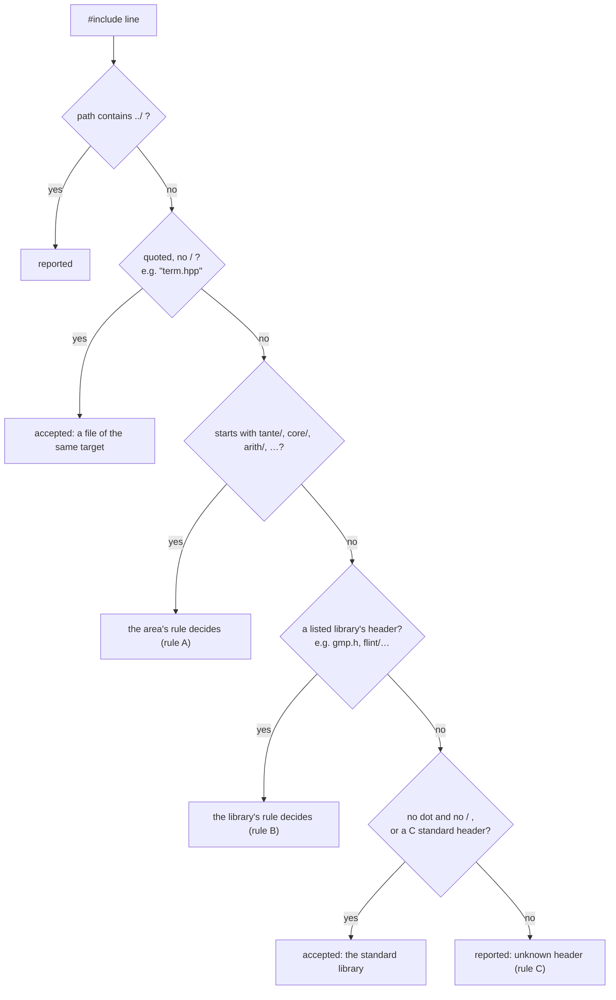

# Include check: check_architecture.py

[tools/check_architecture.py](../../tools/check_architecture.py) checks that every `#include` in Tante's C and C++ files is one its directory may use. It keeps the [dependency rules](../architecture.md#dependency-rules) between Tante's [targets](../glossary.md#target) true, and keeps each library's headers, such as [GMP](../glossary.md#gmp)'s, inside its [adapter](../glossary.md#adapter) ([REQ-096](../requirements.md#req-096)). [ADR-0004](../adr/0004-library-first-target-structure.md) point 5 decided it. The build graph alone is not enough: [vcpkg](../glossary.md#vcpkg) installs every library's headers into one folder, so code that may use GMP could include [FLINT](../glossary.md#flint) and still compile.

## When it runs and what a failure blocks

The job `include-check` of [ci.yml](../../.github/workflows/ci.yml) runs it on every pull request and every push to `main`, after its own tests. A finding fails the job, and the pull request cannot be merged.

## How it reads the code

It reads every `.h`, `.hpp`, `.c` and `.cpp` file under `include/`, `src/`, `modules/`, `examples/` and `tests/`, except inside a folder named `build`. In each file it finds the `#include` lines and sorts each header into one of five kinds, in this order:



Tante's own headers are included by their path: the public [API](../glossary.md#api) as `tante/version.hpp` (from `include/`), an internal target's header as `core/term_view.hpp` (from `src/`). A header in the same folder may be included by its name alone.

## Rule A: a directory includes only the targets it may use

The file's **area** is the longest directory in the table below that contains it. The area names the header prefixes it may include. An arrow in the [building-blocks diagram](../architecture.md#5-building-blocks) means "may use", and so does a chain of arrows, except where a dependency rule says "only".

| Area | May include | Because |
|---|---|---|
| `include/tante/module/` | `tante/module` | the [module](../glossary.md#module) SDK stands alone, for authors outside the repository ([REQ-032](../requirements.md#req-032)) |
| `include/tante/` | `tante/` | the public API |
| `src/cli/` | `tante/` | the command-line tool uses only `tante_api` ([REQ-064](../requirements.md#req-064)) |
| `src/api/` | `tante/`, `api/`, `lang/`, `form/`, `core/`, `arith/`, `platform/`, `adapters/` | the one place that chooses the adapters |
| `src/lang/`, `src/form/` | their own, `core/`, `arith/`, `platform/`, `tante/module` | the two [front ends](../glossary.md#front-end) never include each other ([REQ-022](../requirements.md#req-022)) |
| `src/core/` | `core/`, `arith/`, `platform/`, `tante/module` | |
| `src/adapters/flint/`, `…/simple/`, `…/arb/` | their own, `arith/` | an adapter implements an interface of `tante_arith` |
| `src/arith/` | `arith/` | |
| `src/platform/` | `platform/` | |
| `modules/`, `examples/` | `tante/module` | modules use only the module SDK ([REQ-030](../requirements.md#req-030)) |
| `tests/` | everything | tests test every target |

The message is `<file>:<line>: <area> may not include <header>: it may include only <prefixes>`.

| Line, in file | Result |
|---|---|
| `#include "arith/rational.hpp"` in `src/core/term.cpp` | accepted |
| `#include "core/term.hpp"` in `src/arith/rational.cpp` | reported: nothing points upwards |
| `#include "core/term.hpp"` in `src/cli/main.cpp` | reported: the tool uses only the public API |
| `#include "core/term.hpp"` in `modules/linalg/matrix.cpp` | reported: modules use only the SDK |
| `#include "tante/version.hpp"` in `include/tante/module/handles.h` | reported: the SDK stands alone |
| `#include "term.hpp"` in `src/core/term.cpp` | accepted: same folder |
| `#include "../core/term.hpp"` anywhere | reported: `climbs out of its directory` |

A file in a directory with no row is reported as `no rule for this directory: add it to AREAS in tools/check_architecture.py`. A new target gets its row in the same pull request that adds it, together with its row in the [architecture](../architecture.md#5-building-blocks).

## Rule B: a library's headers only in its adapter

| Library | Recognised by | Only in |
|---|---|---|
| GMP | `gmp.h`, `gmpxx.h` | `src/arith/`, where `Integer` and `Rational` are implemented |
| FLINT | `flint/…` | `src/adapters/flint/`, `src/adapters/arb/` |
| [MPFR](../glossary.md#mpfr) | `mpfr.h`, `mpf2mpfr.h` | nowhere: a dependency of FLINT that Tante does not call ([ADR-0003](../adr/0003-flint-gmp-arb-behind-own-interfaces.md) §1) |
| Catch2 | `catch2/…` | `tests/` |
| the operating system | `windows.h`, `dlfcn.h`, `unistd.h`, `sys/…`, `mach-o/…` | `src/platform/` ([REQ-050](../requirements.md#req-050)) |

The message is `<file>:<line>: <header> is <library>'s: only <directories> may include it`, or `… which Tante does not include directly` for MPFR.

| Line, in file | Result |
|---|---|
| `#include <gmp.h>` in `src/arith/integer.cpp` | accepted |
| `#include <gmp.h>` in `src/core/term.cpp` | reported |
| `#include <flint/fmpz.h>` in `src/arith/rational.cpp` | reported: FLINT's `fmpz` is not Tante's integer type ([ADR-0003](../adr/0003-flint-gmp-arb-behind-own-interfaces.md) §2) |
| `#include <windows.h>` in `src/core/memory.cpp` | reported |

Every dependency in `vcpkg.json` must have a row here. Otherwise the check reports `vcpkg.json: dependency '<name>' has no entry in LIBRARIES in tools/check_architecture.py`. A library cannot then enter the manifest without someone deciding where its headers may go.

## Rule C: every header is known

A header in angle brackets without a dot and without a folder, such as `<vector>` or `<cstdint>`, is the C++ standard library's. So are the C standard headers that the C [module interface](../glossary.md#module-interface) needs (`<stdint.h>`, `<stddef.h>`, `<stdbool.h>`, `<stdlib.h>`, `<string.h>`, `<assert.h>`). Any other header that is neither Tante's nor a listed library's is reported: `<header> is not a known header: add its library to LIBRARIES in tools/check_architecture.py`.

| Line | Result |
|---|---|
| `#include <vector>` | accepted |
| `#include <stdint.h>` in `include/tante/module/handles.h` | accepted |
| `#include <boost/container/small_vector.hpp>` | reported |

## When it fails

Each line names the file and line of the `#include`, then what is wrong.

- **A rule A finding** means the code reaches across a layer. Do not widen the area's row. Move the code to the target that may use the header, or give the lower target an interface that the higher one implements, as `PolynomialBackend` does for FLINT. Changing a row is a change of the architecture. It needs the [architecture](../architecture.md#5-building-blocks) updated in the same pull request, and an [ADR](../glossary.md#adr) if it changes a decision.
- **A rule B finding** means a library's type is leaking out of its adapter. Convert to Tante's own type at the adapter's boundary instead ([REQ-096](../requirements.md#req-096)).
- **A rule C finding, or a vcpkg.json finding,** means a new library. Add a `Library` row to `LIBRARIES` with the directories that may include it, and a row to rule B's table above.
- **`no rule for this directory`** means a new folder. Add its `Area` row and a row to rule A's table above.

There are no exemptions per line. The rules are the architecture, so a change to them is reviewed like one.

## Running it locally

```bash
python tools/check_architecture.py .
python -m unittest discover -s tools/tests
```

The first checks the repository and prints each finding, then `check_architecture: <n> finding(s)`. It exits with 0 when there is none, 1 when there are findings, and 2 on wrong usage. The second runs its tests, [tools/tests/test_check_architecture.py](../../tools/tests/test_check_architecture.py). Each test builds a small repository in a temporary folder and checks one case of the tables above.
