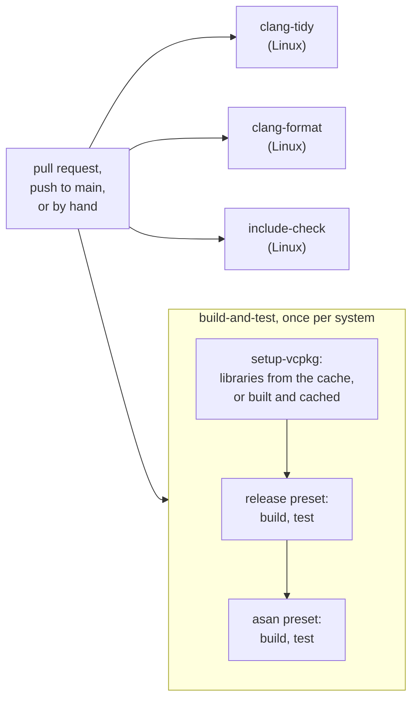

# CI workflow: ci.yml

[ci.yml](../../.github/workflows/ci.yml) checks that every change to Tante builds and passes its tests on Windows, macOS and Linux, and that the guardrails of [ADR-0001](../adr/0001-cpp20-cmake-vcpkg-guardrails.md) point 3 and [ADR-0004](../adr/0004-library-first-target-structure.md) point 5 hold.

## When it runs and what a failure blocks

It runs on every pull request, on every push to `main`, and by hand (Actions → ci → Run workflow). A newer push to the same branch cancels the run still going. A pull request with a failed job cannot be merged: a change that fails on one system is not merged ([ADR-0001](../adr/0001-cpp20-cmake-vcpkg-guardrails.md) point 5).



The four jobs run side by side. Each one's result appears as its own check on the pull request.

## The libraries and their cache

Every job that compiles first runs the step [setup-vcpkg](../../.github/actions/setup-vcpkg/action.yml). It clones [vcpkg](../glossary.md#vcpkg) at the commit the workflow names in `VCPKG_COMMIT` and builds the libraries of `vcpkg.json` for the job's [triplet](../glossary.md#triplet). The built libraries are kept in GitHub's cache, one entry per triplet, vcpkg commit and content of `vcpkg.json`. A run with an unchanged `vcpkg.json` takes them from the cache in seconds. A changed `vcpkg.json` starts from the previous entry and builds only what changed. The build of the native-arithmetic [spike](../glossary.md#spike) took 49 minutes on Windows without the cache, with [GMP](../glossary.md#gmp), [MPFR](../glossary.md#mpfr) and [FLINT](../glossary.md#flint) in its manifest. Tante's manifest gets them in the next pull requests. The cache is saved before Tante itself is built, so a failing test never throws that build away.

**Rule: vcpkg.json's `builtin-baseline` is the commit in `VCPKG_COMMIT`.** The baseline fixes the library versions that every machine builds ([ADR-0003](../adr/0003-flint-gmp-arb-behind-own-interfaces.md) §1). If CI cloned another vcpkg commit, it would test versions nobody pinned. The step compares the two and fails with `builtin-baseline <a> differs from VCPKG_COMMIT <b> in .github/workflows/ci.yml`.

| Change | Result |
|---|---|
| both moved to the same new commit in one pull request | accepted |
| `vcpkg.json` moved, `ci.yml` not | reported |
| `ci.yml` moved, `vcpkg.json` not | reported |

Moving the baseline is a deliberate commit of its own, `build(deps): …`, that passes the whole test suite ([ADR-0003](../adr/0003-flint-gmp-arb-behind-own-interfaces.md) §1).

## build-and-test

**Rule: Tante builds without a warning, and every test passes, in Release and under the [sanitizers](../glossary.md#sanitizer), on Windows, macOS and Linux.**

Why: the supported compilers are exactly those CI builds with ([ADR-0001](../adr/0001-cpp20-cmake-vcpkg-guardrails.md) point 1). A warning is often a bug that has not happened yet, for example a 64-bit value narrowed to 32 bits. The sanitizers turn undefined behaviour, which C++ lets pass silently, into a failed test.

How it decides: each system's job configures, builds and tests two [presets](../glossary.md#preset), for example `linux-gcc-release` and then `linux-gcc-asan`. Every preset turns warnings into errors. `ctest` fails when a test fails, and also when it finds no tests at all.

| Case | Result | Why |
|---|---|---|
| a clean build, all tests pass on all three systems | accepted | |
| `int count = values.size();` | reported on all three: [GCC](../glossary.md#gcc) and Clang `-Wconversion`, [MSVC](../glossary.md#msvc) C4267 | a `size_t` narrowed to `int` |
| `long total = 0;` used for a sum beyond 2³¹ | not reported by the compilers; a test with such a sum fails on Windows only | `long` has 32 bits there, so Tante's code uses `std::int64_t` |
| a test reads one element past a `std::vector`'s end | reported by the `asan` preset: `heap-buffer-overflow` | AddressSanitizer |
| a signed `std::int32_t` overflows | reported by the Linux and macOS `asan` presets: `signed integer overflow` | UndefinedBehaviorSanitizer, which MSVC lacks |
| a warning inside a third-party header | accepted | third-party headers are system headers, whose warnings are off |
| no test discovered | reported: `No tests were found` | a broken test registration would otherwise pass |

## clang-tidy

**Rule: clang-tidy reports nothing in `src/` and `tests/`.** clang-tidy is a linter for C++, like the Roslyn analysers in .NET. It enforces most of the [coding guideline](https://github.com/thomaswening/claude-config/blob/main/skills/coding-guideline/references/cpp.md#checked-by-tools)'s rules for C++ and, beyond it, likely bugs and slow code (the `bugprone-*` and `performance-*` groups). It is the [static analysis](../glossary.md#static-analysis) of [ADR-0001](../adr/0001-cpp20-cmake-vcpkg-guardrails.md) point 3. Its configuration is [.clang-tidy](../../.clang-tidy), and every check is an error.

How it decides: the job configures the preset `linux-clang-tidy`, which writes `compile_commands.json`, the exact compiler flags for each file. Then it runs clang-tidy 23 on every `.cpp` file in `src/` and `tests/` that git tracks, and on the project's headers they include. A finding prints `file:line:column: error: <what> [check-name]`.

| Case | Result | Check |
|---|---|---|
| `constexpr int columns = 26;` | reported: `invalid case style for constexpr variable` | `readability-identifier-naming`; write `kColumns` |
| `int w = 0;` | reported: `variable name 'w' is too short` | `readability-identifier-length` |
| `if (line.size() > 80)` | reported: `80 is a magic number` | `readability-magic-numbers` |
| `main` lets an exception escape | reported: `an exception may be thrown in function 'main'` | `bugprone-exception-escape` |
| `for (auto value : strings)` copying each string | reported | `performance-for-range-copy`; write `const auto&` |
| a finding inside Catch2's or the standard library's headers | not reported | only the project's own headers are checked |

**When it fails.** Fix the code the message names. If the finding is wrong in this one place, silence that line with `// NOLINT(check-name)` and a comment that says why. A `NOLINT` without a check name silences everything on the line, so it is not used. A check that is wrong for the whole project is turned off in `.clang-tidy` with the reason, in a pull request of its own.

## clang-format

**Rule: every C++ file is laid out exactly as clang-format writes it.** Layout is then never a review question ([ADR-0001](../adr/0001-cpp20-cmake-vcpkg-guardrails.md) point 3). The style is [.clang-format](../../.clang-format): Google's, with lines up to 100 characters.

How it decides: clang-format 23 runs in dry-run mode on every `.cpp`, `.hpp`, `.h` and `.c` file that git tracks, and reports each file it would change: `file:line:column: error: code should be clang-formatted [-Wclang-format-violations]`.

| Case | Result |
|---|---|
| a file as clang-format left it | accepted |
| a line of 101 characters | reported |
| `#include` lines in another order than clang-format sorts them | reported |

**When it fails.** Run clang-format on the file, commit the result:

```bash
clang-format -i src/cli/main.cpp
```

Visual Studio and VS Code format with the same file when you save, if "format on save" is on. They must use version 23, since versions differ in small ways.

## include-check

**Rule: every `#include` is one its directory may use.** The rules, their cases and what to do when it fails: [check_architecture.md](check_architecture.md).

## Running it locally

The build and tests: [Build and test](../development.md#build-and-test). The other jobs need Python 3 and, for clang-tidy, the presets' compile commands, which only Makefile and Ninja builds write. On Windows that means WSL or a Linux machine.

```bash
pip install clang-tidy==23.1.4 clang-format==23.1.5
cmake --preset linux-clang-tidy
git ls-files 'src/*.cpp' 'tests/*.cpp' | xargs clang-tidy -p build/linux-clang-tidy --quiet
git ls-files '*.cpp' '*.hpp' '*.h' '*.c' | xargs clang-format --dry-run --Werror
python -m unittest discover -s tools/tests
python tools/check_architecture.py .
```

The workflow pins the two tools' versions in `CLANG_TIDY_VERSION` and `CLANG_FORMAT_VERSION`. Use the same locally.
